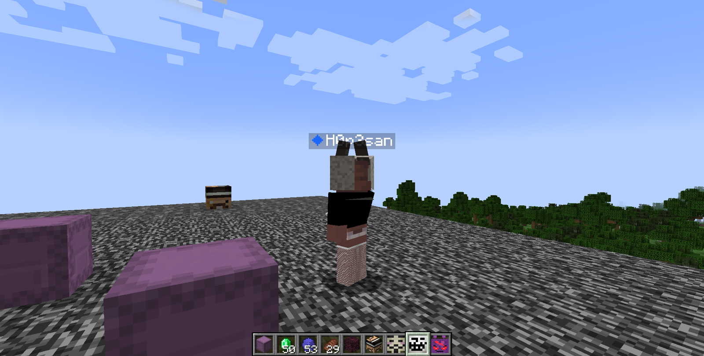
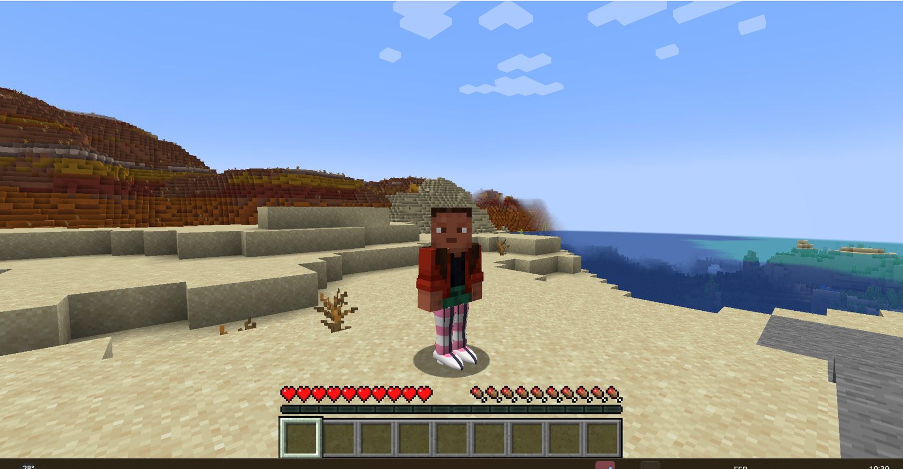
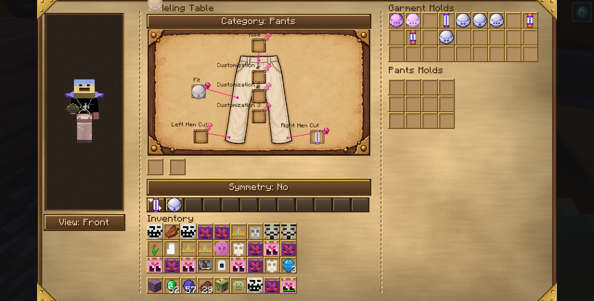
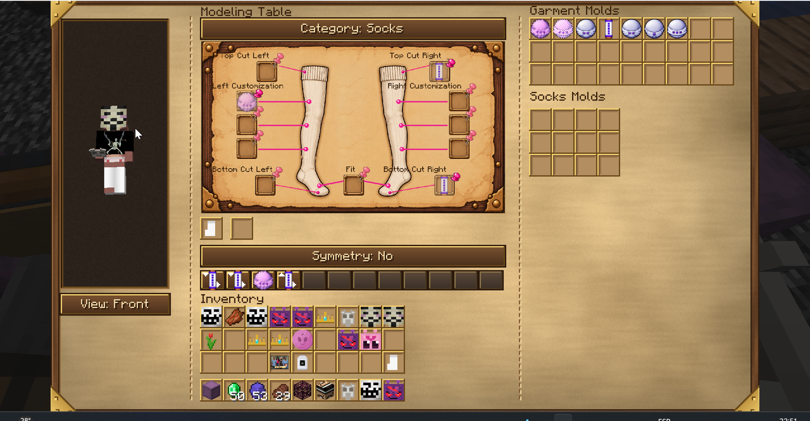
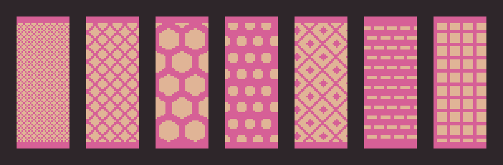
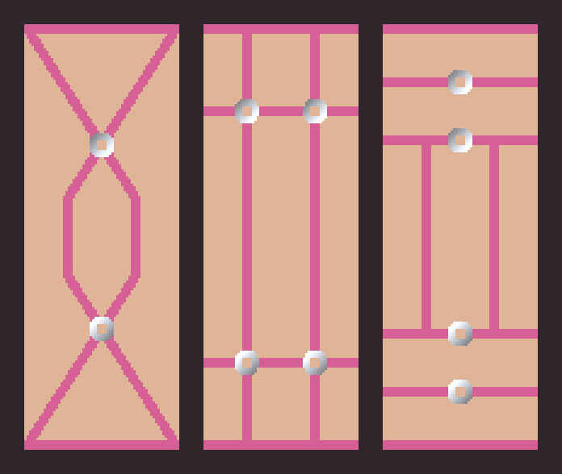
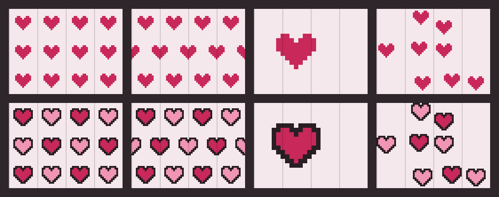
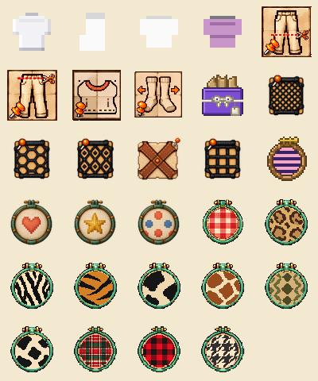

# ModaMod — Manual del mod

Versión del mod: 0.1.0-alpha · Minecraft 1.21.1 (Fabric) · Manual actualizado: 2026-10-28

Licencia: el código es MIT (`LICENSE`); los assets (texturas, modelos, animaciones, íconos, idiomas) tienen todos los derechos reservados (`LICENSE-ASSETS`).

ModaMod agrega ropa que se viste SOBRE el cuerpo del personaje: remeras, pantalones, medias, calientabrazos, polleras y capas que siguen la forma del modelo, se superponen en capas (una media debajo de un pantalón, una remera arriba de todo) y se pueden personalizar casi por completo: el corte, el color, los patrones, las estampas con fotos y hasta la trama de la tela (redes, encaje, arneses).

La personalización pasa por cuatro máquinas, cada una con su trabajo (más el Maniquí para exhibir y la Mesa de estilado para los apliques):

| Máquina | Qué hace |
|---|---|
| **Mesa de Modelado** | El CORTE: largo de mangas, de pierna, tiro, cuello, calce (holgura) y la trama (red, arnés). |
| **Estación de Tintes** | El COLOR: colores lisos o con patrones (rayas, corazones, estrellas, lunares, vichy, tartán, leñador, pata de gallo, animal print), por zona de la prenda y mezclando capas. |
| **Sublimadora** | Las ESTAMPAS: imprime fotos (del mod Camerapture) sobre la prenda. |
| **Guardarropas** | GUARDAR tu outfit completo con nombre y ponértelo entero. |
| **Maniquí** | EXHIBIR un outfit: la ropa se ve puesta en la figura, que puede girar. |
| **Mesa de estilado** | APLIQUES 3D (moño, mariposa, flor) pegados a cualquier prenda. |

## 1. Requisitos e instalación

- Minecraft **1.21.1** con **Fabric Loader** y **Fabric API**.
- **Trinkets** (obligatorio): la ropa se viste en slots de Trinkets, no en los de armadura.
- **GeckoLib** (obligatorio): las máquinas son modelos animados.
- **Camerapture** (opcional): solo hace falta para la Sublimadora (las fotos salen de ahí).
- **3D Skin Layers** (opcional): compatible; el mod ajusta la segunda capa de la skin debajo de la ropa.
- **CARAS** (opcional): con una cabeza de CARAS puesta, la **capucha** levantada y los **sombreros** se dibujan igual, un poco agrandados para que la cabeza no los atraviese; las máscaras, el barbijo y el cuello de polera no se ven (2026-10-25).
- **Armadura** (2026-10-28): la armadura que se ve (la de los cosméticos si la cambiás u ocultás) infla la capa: con **pechera**, el paño, la capelet, el embozo y la capucha caída se alejan 1 px y el choque con los brazos también; con **casco**, la capucha levantada crece un 25 % desde el cuello (con una cabeza de CARAS vale el mayor de los dos). La élitra no cuenta.

Se instala como cualquier mod: el `.jar` va en la carpeta `mods` del perfil.

## 2. Primeros pasos: el recorrido completo

1. **Crafteá una prenda base** (ver Recetas): por ejemplo una remera con 8 lanas del mismo color, o unas medias con 6 lanas.
2. **Vestila:** abrí el inventario, pestaña de Trinkets, y poné la prenda en su slot (torso, piernas, medias o brazos).
3. **Cambiale el corte** en la Mesa de Modelado: poné los moldes en el dibujo de la prenda, fijalos con la chincheta, poné la prenda en la Entrada y cerrá la interfaz.
4. **Teñila** en la Estación de Tintes: elegí zonas del dibujo, poneles color y patrón, fijalos y apretá Teñir.
5. **Estampala** en la Sublimadora con una foto.
6. **Guardá** tu outfit completo en el Guardarropas, con nombre.

Cada máquina **no consume la prenda ni los moldes**: la prenda sale modificada y los moldes y patrones se reusan para siempre. Lo que se gasta son los insumos: tinta (tintes vanilla) y papel.

## 3. Las prendas

| Prenda | Slot de Trinkets | Se modela | Se tiñe | Se estampa |
|---|---|---|---|---|
| Remera | Torso | Largo, mangas (por lado), cuello, calce, trama | Sí | Sí (frente y espalda) |
| Pantalón | Piernas (exterior) | Largo de pierna (por lado), tiro, calce, trama | Sí | Sí |
| Medias | Medias | Largo arriba y abajo (por lado), calce, trama | Sí | Sí |
| Calientabrazos | Brazos | Cobertura arriba y abajo (por lado), calce, trama | Sí | Sí |
| Pollera | Piernas (exterior) | Forma (campana o tableada), largo (6), calce, trama | Sí | Sí (frente y espalda) |
| Capa | Espalda | Largo (7), ruedo (recto, redondeado o con cola), capucha, cuello alto | Sí (exterior, forro y detalles por separado) | Sí (Frente = exterior, Espalda = forro) |
| Chaqueta (Hoodie) | Chaqueta | Igual que la remera (en las máquinas cuenta como remera) | Sí | Sí (frente y espalda) |

**Capas de dibujo.** Las prendas se dibujan en orden fijo, así una no borra a la otra: cuerpo base → medias → calientabrazos → pantalón → remera → pollera → chaqueta. Donde una prenda no tiene tela (una media corta, una remera sin mangas) se ve lo que hay abajo.

**El ícono muestra la prenda de verdad.** Los íconos de remera, pantalón, pollera, capa, medias y calientabrazos son de 64×64 y se arman con la misma tela que se ve puesta: aparecen las capas y los patrones de Tintes, cada manga o pierna con su color, las redes y los arneses, las fotos de la Sublimadora y el largo real (manga corta, crop, short, zoquete). La remera tiene un dibujo por cuello (redondo, V, polera, cuadrado, corazón).

**La pollera** es una malla propia que baja desde la cintura y se abre hacia el ruedo. Puede ser **campana** (lisa) o **tableada** (pliegues en V) y tiene 7 largos, del ultramicro hasta el tobillo. **Se mueve con vos:** la tela choca con las piernas (con su forma y su pose reales: caminando, agachada, sentada o nadando, la pierna la empuja hacia afuera y nunca la atraviesa), el ruedo queda atrás al caminar o correr, se abre al caer, se achica al saltar, se balancea de costado y se retuerce un poco con cada paso (la misma inercia que usa la capa vanilla). **Cuelga hacia abajo** aunque te agaches: el torso se inclina pero la tela no se va para atrás, así las piernas no la atraviesan ni la estiran como una bolsa. Con busto, pasa tirante por fuera de la cola (sin meterse entre las nalgas). **Twirl:** con una pollera puesta, apretá **R** (se cambia en Controles → ModaMod → "Girar (con pollera)") y el personaje da una vuelta entera con los brazos abiertos mientras la pollera se abre casi horizontal y gira arrastrada; los demás jugadores también lo ven. Su tela tiene el mismo formato que las demás prendas, así que se tiñe con patrones y zonas, se estampa y se le puede poner red. **Los patrones no se deforman:** lunares, motivos y rayas miden lo mismo en la cintura que en el ruedo y de frente que de costado, en cualquier forma y largo (el dibujo se "despliega" sobre la campana, como el molde de una pollera real; la costura queda en el centro de la espalda). La cintura es casi recta y tapa sola la unión con el torso (ya no hay cinto aparte). **Varias polleras:** si llevás más de una (el slot de Pantalón/pollera tiene 3 lugares), se dibujan todas, una debajo de otra según el slot: la de más arriba en la lista queda abajo y cada una siguiente sale un poco más afuera; igual en el Maniquí y el Guardarropas. Los motivos de la pollera se dibujan a resolución completa (antes se achicaban a la mitad y salían borrosos).

**La capa** cuelga de los hombros y se mueve como tela: usa la misma inercia que la capa vanilla (se levanta al correr, rebota con los saltos, se balancea de costado y se abre al agacharte), pero no es una placa rígida: arriba sigue a la espalda y se va curvando hacia el ruedo, le baja una onda al moverte, se mece un poco quieta y se abre lo necesario para no atravesar las piernas. Va en su propio slot de Trinkets, **Espalda**. Tiene 7 largos (del capelet al tobillo), ruedo **recto**, **redondeado** (las puntas suben en arco) o **con cola** (10 px de tela de más que se apoyan en el piso y se arrastran detrás de vos; sentado, montado, nadando, durmiendo o gateando no se apoya), **capucha** caída sobre la espalda (con **H** te la ponés) y **cuello alto** abierto detrás de la cabeza; todo se elige en la Modeladora. El **forro** (la cara de adentro) se tiñe y se estampa aparte del exterior. **La del mod manda:** con una capa del mod puesta, la capa vanilla (de Minecraft o de Optifine/Minecon) no se dibuja; con élitros puestos es al revés, se ven los élitros y la del mod se esconde.

**Embozo, cuello alto y capucha de la capa.** El **embozo** es la esclavina que cubre los hombros: se pone con su molde en la Modeladora y tiene **7 largos** (2, 5, 8, 12, 16 y 20 px, y hasta el piso). Choca con las piernas y los brazos como la pollera y, cuando llega al piso, se abre un poco en el ruedo. **Desde el largo de 12 px el embozo hace de capa**: el paño de atrás ya no se dibuja, y los apliques y correas de la capa pasan al embozo, en el mismo lugar de la tela. Con la tecla **J** (la de abrir la chaqueta) el embozo apenas abre en el cuello y se va abriendo hacia abajo: los bordes del frente caen en diagonal por los hombros hacia los costados y la espalda. El **cuello alto** rodea la nuca por atrás. La **capucha** de la capa, puesta o caída sobre la espalda, es de malla o de cajas según su molde, se apoya por fuera del paño o del embozo y se tiñe con la zona **Detalles**. Si también tenés una chaqueta con la capucha caída, esa capucha va por fuera del embozo sin deformarlo.

**Dónde se ponen.** En el inventario, al lado del muñeco hay una columna con tres lugares: **Remera/Chaqueta** (arriba), **Pantalón o pollera** y **Medias** (abajo). Pasando el mouse por un grupo se despliegan sus lugares. La **Capa** se abre desde el slot de la **pechera** (como los élitros) y los **Calentadores de brazo** desde el de la **mano secundaria**. Cada slot tiene un dibujito de la prenda que lleva y, vacío, al pasar el mouse dice qué va ahí, en qué capa se dibuja y cuántos lugares tiene.

**Pantalla de Ropa, Guardarropas y Maniquí** (2026-10-25): las tres muestran los mismos lugares en el mismo orden: arriba **sombrero, máscara y barbijo**; después **collar y capa**; una fila por prenda (chaqueta, remera, calentadores, pantalón o pollera, medias) y, debajo del muñeco, **delantal, cinto y calzado**. Al pasar el mouse por un lugar vacío, un cartel dice qué va ahí. El Guardarropas guarda en los outfits también la máscara y el barbijo, y el Maniquí los viste e intercambia con vos.

**Varias prendas del mismo tipo.** Cada slot de Trinkets tiene **4 lugares**: se pueden llevar a la vez un croptop sobre un remerón largo, o medias de red debajo de unas medias cortas.

**La remera** sale en los 16 colores de lana. Su nombre cambia según el corte (croptop, musculosa, polera, remerón, remera) y el resto del corte aparece en el tooltip. Los cuellos son **redondo, en V, polera, cuadrado y corazón** (un molde de cuello por cada uno, con su dibujo). El cuadrado y el corazón no tienen archivos propios: el juego recorta el escote al armar la tela. El **cuadrado** es un recorte recto en el frente; el **corazón** es más ancho y sus dos lóbulos siguen la parte de arriba de cada pecho hasta una punta al centro; la tela empieza justo arriba del medio del pecho. La tapa de arriba de la prenda (por la que asoma el cuello) tiene el mismo ancho que el corte del frente. Con el cuello **polera** lleva un **cuellito** alto en 3D alrededor del cuello (acanalado, del color de la remera; tapa la barbilla, no la boca).

**Hoodie con otras prendas.** Con **pollera**, el ruedo del hoodie se abre por fuera de la pollera (el elástico no la aprieta) y la pollera asoma por debajo. Con **capa**, la capa cuelga por fuera del hoodie y de su capucha caída; la capucha y el cuello alto de la capa no se dibujan (manda la del hoodie). La **capucha puesta** cierra abajo y alrededor de la cara (marco de forro también bajo la barbilla).

**Silueta del hoodie.** El torso del hoodie va **más pegado arriba y se ensancha hacia abajo** (al 35 % de la holgura en el pecho y al 100 % en el ruedo), con el ruedo elástico que aprieta al final. Donde la tela se estrecha de golpe (el puño y el ruedo elásticos) hay un anillo de tela que tapa el borde, así no se ve el interior desde abajo.

**Mangas y ruedos.** En las prendas holgadas, los costados del torso y el lado de adentro de las mangas (donde se tocan) casi no se inflan, así manga y torso no se meten uno en el otro. La boca de las mangas, las botamangas y los ruedos cortados se cierran con un anillo de tela entre la prenda y el cuerpo (ya no se ve el hueco).

**Chaquetas.** Categoría nueva que va **encima de la remera y de la pollera**, en su propio slot de Trinkets (**Chaqueta**, 4 lugares). La primera es el **Hoodie**: sale largo, con manga larga y calce **Oversize**, y tiene bolsillo canguro, puños y ruedo **elásticos** (la última fila aprieta y la tela hace globo arriba, sin colgar), **cordones** y **capucha**. **Capucha:** apretá **H** (Controles → ModaMod → "Subir/bajar capucha") para ponértela o bajarla; los demás lo ven. La misma tecla sube y baja la capucha de la **capa**. En las máquinas el hoodie se trata como una remera: la Modeladora le cambia largo, mangas, cuello, calce y trama con los mismos moldes, Tintes usa las zonas de la remera y la Sublimadora estampa frente y espalda (comparte los diseños guardados de la remera). La capucha y los cordones son lisos, del color base (no llevan patrones ni fotos todavía).

**Chaqueta modular** (2026-10-07, "como se te ocurre que mejor hacemos las chaquetas"). La chaqueta tiene **su propia categoría en la Modeladora** (la prenda que ponés en la máquina elige la pestaña sola). Usa los moldes de siempre para el **cuello**, las **mangas** (los dos lados), el **largo** (el pin del torso), el **calce** y los 3 **materiales**, y suma tres pines propios con **moldes de Chaqueta**: **Frente** (cerrado o **abierto**: una franja del medio queda transparente y se ve lo que llevás debajo, con las dos orillas más oscuras), **Capucha** (con o sin: sin capucha no hay capucha, cordones, bolsillo canguro ni tecla H) y **Remate** (puños y ruedo **elásticos** o **rectos**). De fábrica es el hoodie de siempre (frente cerrado, con capucha, elástico). El nombre cambia solo según el corte: **Hoodie**, **Hoodie abierto**, **Buzo** (sin capucha), **Campera** (sin capucha y abierta), **Chaleco** y **Chaleco abierto** (sin mangas en los dos lados). **Bolsillos y botones** se ponen con **apliques** en la Estilista, no son moldes. Los moldes de cuello y de manga se guardan también en el banco de la categoría Chaqueta. **Traje** (2026-10-07, "traje separado"): la chaqueta suma un 4.º pin, **Solapa**, con moldes de **Chaqueta**: **sin solapas**, **en pico**, **redondas** y **chal** (esmoquin). Son dos tiras de tela que bajan del cuello a cada lado del frente, armadas con cajitas de 1 px; con busto cada una sube hasta apoyarse sobre la cúpula. Con solapas y sin capucha el nombre pasa a **Saco** (o **Saco cerrado**). Además hay un **cuello de camisa** (molde de cuello **Camisa**, para la remera): escote en V chico y dos puntas que asoman por encima de un saco. El traje se arma separado: saco (chaqueta abierta, sin capucha, remate recto, solapas) + pantalón de vestir + remera de cuello camisa. *(Pendiente: corbata como zona de la Banda, y abrigos largos, que necesitan una falda de malla como la de la pollera.)*

**Casilleros desplegables y ruedos** (2026-10-08). Cada pin principal que tiene un par lleva un botón **▾** al lado: **manga ↔ puño**, **cuello ↔ solapa**, y en el pantalón, las medias y los calientabrazos **corte ↔ ruedo** de cada botamanga y de cada borde. Al abrirlo aparece el segundo casillero con su marco, y **los dos aceptan cualquiera de los dos moldes** (un molde de rango en el del puño corta la manga; uno de ruedo en el de la manga arma el puño). Se abre solo si ya tiene un molde o un corte puesto y no se cierra con algo adentro. Hay **una sola Trama** por prenda (antes eran tres de Personalización). El **molde de ruedo** (recto, ajustado, campana; ondulado, festoneado y pico solo en la pollera) funciona en botamangas y bordes de medias y calientabrazos con la geometría (ajustado aprieta la última fila, campana abre las últimas tres) y en la **pollera** (ajustado cierra el ruedo contra las piernas, campana lo abre). **Frente de la chaqueta:** además de cerrado y abierto, hay **cruzado** (una solapa monta sobre la otra, con costura corrida) y **abierto hasta el pecho** (la apertura baja 6 filas y de ahí cierra); el ancho de la apertura crece con el calce (2 px hasta Normal, 3 Suelto, 4 Oversize), y en las prendas holgadas el busto también se abre por el medio (no queda tela cruzando la apertura). Los ruedos **ajustados** de botamangas, medias y calientabrazos llevan además **rib** (canales) pintado en esa fila.

**Sombrero de bruja** (2026-10-04, "modelemos y agreguemos un sombrero de bruja"). Va en su **propio slot de Trinkets** (**Sombrero**, en el grupo de la cabeza, aparte del casco: se puede llevar con casco, con la capucha del hoodie y con apliques). Está hecho de cajas que se afinan hacia arriba: un **ala** plana (ancha o corta), un **cono** de cuatro tramos y una **cinta** alrededor de la base, más una **punta** de dos tramos, **recta o doblada** hacia atrás, que se **mece con el movimiento** (la misma tela blanda de los apliques: al correr o saltar se inclina). Tiene **3 zonas de color** (ala, cono y cinta) que se pintan en la **Mesa de estilado** (2026-10-05, "que se le apliquen los colores en la mesa de estilado sobre todo si tiene tres areas"): poné el sombrero en la prenda y un **retazo** (teñido en la Estación de Tintes) o una **muestra de color** en el slot del retazo, y apretá **Colorear sombrero**. Aparecen tres filas (**Ala**, **Cono**, **Cinta**) con un botón por cada color del retazo (■ en su color): el que apretás le pasa ese color a esa zona; **Retazo entero** pasa los 3 colores del retazo a las 3 zonas de una. **No se gasta el retazo** (el color se copia). Con una muestra de color, los 3 botones dan el mismo color. **También podés clickear el sombrero en la vista 3D**: la zona que tocás (ala, cono o cinta; al pasar el mouse aparece su nombre) se pinta con el **color activo**, que es el último botón ■ que apretaste (se marca con corchetes) y se ve en el texto de ayuda. **Volver a apliques** devuelve los controles de siempre. Sale **blanco de fábrica**; las zonas que no pintás se quedan como están. Como cualquier ítem puesto, **admite apliques** de la Mesa de estilado, que por ahora se apoyan en la caja de la cabeza (no en el cono). **Moldes en la Modeladora** (2026-10-05, segunda tanda): la categoría **Sombrero** (botón de categoría) tiene un esquema con dos pines, **Ala** (molde de sombrero: ala ancha o corta) y **Punta** (recta o doblada); poné el sombrero en el slot de prenda, soltá los moldes en los pines y fijá con la chincheta como en el resto. Los 4 moldes están en la pestaña creativa y la Modeladora creativa ya los trae. **Dibujo por zona** (2026-10-05): en modo Colorear, cada fila (Ala, Cono, Cinta) tiene a la derecha un botón que cicla el dibujo de esa zona — Liso, Rayas, Rayas verticales, Lunares, Cuadros —, pintado con el color de la zona y un tono de contraste (más claro si es oscuro, más oscuro si es claro). **Apliques sobre el ala y el cono**: el click en la vista 3D apunta a la superficie del sombrero (ala, cono, cinta o punta) y el aplique queda apoyado ahí, ya no sobre la caja de la cabeza. **Maniquí y Guardarropas**: un slot más (debajo de la columna de armadura) para el sombrero; se ve en la figura, en la vista previa y "Equipar"/"Intercambiar" lo pasan al slot de sombrero de Trinkets.

**Bandas: cintos y chokers** (2026-10-05, "correas y cintos"). Un ítem, la **Banda**: un aro que rodea la **cintura** (cinto, slot **Cinto** de Trinkets, encima de la ropa y holgado según lo que lleves puesto) o el **cuello** (choker, slot **Choker**, en la base de la cabeza). Cada zona solo entra en su slot. Tiene un **ancho** (fino, medio, ancho) y un **herraje** al frente (ninguno, placa o aro), y 3 partes con color y dibujo: **Banda**, **Borde** (dos tiras finas arriba y abajo) y **Herraje**. Sale de fábrica de cuero oscuro con herraje dorado. En la **Mesa de estilado** se colorea y se le cambia el dibujo igual que al sombrero (modo "Colorear y dibujar", click en la vista 3D sobre la banda, el borde o el herraje), y se le pueden poner **colgantes**: cualquier aplique o aplique de objeto apoyado sobre cualquier caja de la banda, con su tela blanda. En la pestaña creativa hay un cinto y un choker de fábrica. **Moldes en la Modeladora**: la categoría **Banda** tiene un esquema con tres pines — **Zona** (molde de cintura o de cuello), **Ancho** (fino, medio, ancho) y **Herraje** (sin herraje, placa o aro); poné la banda en el slot de prenda, soltá los moldes en los pines y fijá con la chincheta. Los 8 moldes están en la pestaña creativa y la Modeladora creativa ya los trae. Por ahora no se guardan en el Maniquí ni en el Guardarropas. **Correas libres** (2026-10-05, "correas libres y pensemos un molde de cadenas"): en la Mesa de estilado, con **cualquier cosa** en el slot de prenda (prendas, armaduras, wearables, el sombrero, la banda, la pollera y la capa), poné un **molde de correa** en el slot del molde y apretá **Correas**. Con **dos clicks** en la vista 3D definís la correa: el primero es el inicio y el segundo el fin (una guía amarilla muestra el camino; los dos puntos tienen que estar en la misma parte del cuerpo). El botón **Modo** elige: **Pegada** (da la vuelta por la superficie de la caja entre los dos puntos, también de una cara a otra o a la opuesta, como un arnés) o **Colgante** (solo el primer punto la sujeta y cuelga hacia el segundo con tela blanda, y se mueve con la inercia). **Ancho** va de 1 a 4 px. Abajo de los botones hay una **lista numerada** de las correas de la prenda (hasta 8): elegí una y **Modo** y **Ancho** pasan a cambiar *esa* correa, **Recolorear** le pasa los colores del retazo (sin gastarlo) y **Quitar** saca *esa*; sin ninguna elegida, Quitar saca la última (o cancela el inicio si ya hiciste el primer click). En el **sombrero** y la **banda** la correa se apoya sobre sus cajas (ala, cono, banda, herraje...) y en la **pollera** y la **capa** sigue la tela entre los dos puntos (los dos clicks tienen que estar en la misma prenda); ahí la colgante cuelga del primer punto hacia el segundo. Los **5 moldes** (pestaña creativa) son los estilos: **lisa** (cuero o tela con borde y puntadas), **cadena** (eslabones alternados, color de herraje), **cadena fina** (bolitas de metal), **ojalillos** (tira con agujeros) y **cordón** (con puntas de herraje, para el de la capucha de un hoodie). Los colores salen del retazo del slot del retazo (banda, borde, herraje); sin retazo, cuero oscuro con herraje dorado. Por ahora no se gasta nada (el material se define más adelante). Las colgantes se empujan fuera de la caja de su propia parte en cada cuadro, pero todavía no chocan con las otras partes del cuerpo (un brazo contra el torso).

**Borcegos y slot de calzado** (2026-10-08, "modelame unos borcegos y agreguemos un slot de calzado"). Un ítem nuevo, los **Borcegos**, que va en un **slot de calzado** propio de Trinkets (dentro del grupo de las medias: un solo par, se ve en la pantalla de Ropa, tecla K, al lado del cinto). Son un par de botas de cuero con **caña**, **puntera**, **suela gruesa** y **cordones**, hechas de cajas (se ven los dos pies). Tienen **3 zonas con color y dibujo** —**Cuero**, **Suela** y **Cordones**— que se pintan en la **Estilista** como el sombrero y la banda (de fábrica: cuero marrón, suela casi negra, cordones crema), y admiten **apliques y correas** (se ponen sobre el borcego derecho y el izquierdo los copia espejados). La **Modeladora** tiene una categoría **Calzado** con tres pines: **Caña** (baja, media o alta), **Suela** (chata o de plataforma) y **Botamanga** (el pantalón **por dentro** o **por fuera** de la caña). Con la botamanga **por dentro** el pantalón se corta donde empieza la caña y se ven el cuero y los cordones; **por fuera** el pantalón baja entero y se ensancha sobre la caña (la puntera y la suela asoman). Los 7 moldes y los borcegos de fábrica están en la pestaña creativa. **Maniquí y Guardarropas**: un casillero más (debajo del del sombrero) para el calzado; se ve en la figura y en la vista previa, y "Equipar"/"Intercambiar" lo pasan al slot de calzado de Trinkets. *(El esquema de la categoría Borcegos de la Modeladora y los íconos de sus 7 moldes son provisorios, copias de los de la banda.)* **Cada pie por separado** (2026-10-11, "no se puede independizar derecho e izquierdo?"): el pie izquierdo y el derecho tienen cada uno su **caña**, **suela** y **botamanga** (seis pines en la Modeladora, como las mangas: con la **simetría** activa un molde manda a los dos), sus **colores y dibujos** (en la Estilista, modo Colorear: el botón **Pie: derecho/izquierdo** elige a cuál van los botones; clickear un borcego en la vista también lo elige) y sus **apliques y correas** (se ponen sobre el borcego que clickeás). El botón **Espejar: sí/no** (arriba de la vista, de fábrica prendido) repite, espejado, en el otro pie lo que hagas en uno; apagado, cada pie queda como lo dejaste.

**Nombres del calzado** (2026-10-23, "todas las botas se llaman igual"): el nombre sale de la caña (borcegos bajos, borcegos, borcegos altos, botas altas, zapatos, mocasines, chatitas, zapatos de taco, zapatillas, zapatillas altas, pantuflas; sin caña: sandalias, ojotas con suela chancla o gladiadoras) y la suela le suma "de plataforma", "de cuña" o "con taquito". La punta, el cierre y el detalle siguen en el tooltip.

**Cómo se llaman las prendas** (2026-10-23): cada prenda se nombra por el rasgo que más la define y el resto va al tooltip.
- **Remera:** por el corte (musculosa, remerón, croptop, remera, polera, camisa) y, con capucha, solapas o frente abierto, hoodie, buzo, campera, chaleco o saco.
- **Pantalón:** por dónde termina la pierna, si las dos coinciden: shorts, bermudas, pantalón 3/4, pantalón 7/8 o pantalón.
- **Medias:** con pie son soquetes, medias, medias 3/4 o bucaneras según dónde empiezan; **sin pie** son **calzas** si arrancan arriba del muslo (**calzas cortas** si no pasan la rodilla) y **calientapiernas** si no.
- **Calentadores de brazo:** si llegan a la mano y no al hombro son **guantes** (**guantes largos** si pasan el antebrazo); una tira angosta que no llega a la mano es un **brazalete**.
- **Pollera:** por la forma (tubo, tableada, circular, globo, campana). **Capa:** capelet con el largo cero, capa con capucha. **Banda:** cinto o choker.
- **Sombrero:** gorra (visera), boina (plato), galera (cilindro alto), sombrero vaquero, sombrero charro, tricornio, gorro de cocinero, gorro marinero, gorra de panadero, sombrero de bruja (punta recta o doblada con ala), gorro (sin ala o gorro caído), vincha, cofia o sombrero.
- Si cada lado tiene un largo distinto, queda el nombre genérico (pantalón, medias, calentadores de brazo).

**Máscaras y barbijo** (2026-10-24): el **Antifaz** (una franja sobre los ojos con puntitas a los costados), la **Media máscara** (de la frente a la nariz) y la **Máscara completa** (toda la cara, con ojos y una ranura en la boca) van en el slot **Máscara** de la cabeza; el **Barbijo** (de la nariz al mentón, con pliegues, alambre en la nariz y elásticos a las orejas) va en su propio slot, así que se pueden usar juntos. Salen blancos y se tiñen en la **Estación de Tintes** (categorías Máscara y Barbijo: 3 cuadraditos de prenda entera, con Fondo) y llevan una **foto de la Sublimadora** en el frente (solo frente; sin capas con máscara). Como el sombrero, apagan el volumen de **3D Skin Layers** en la parte de la cabeza que tapan. Recetas (lana e hilo): antifaz `hilo-lana-hilo` en una fila; media máscara `lana×3` sobre `hilo-lana-hilo`; máscara completa `lana×3`, `hilo-lana-hilo`, `lana×3`; barbijo `hilo · hilo` sobre `lana×3`. Íconos provisorios.

**Prendas viejas (armadura), jubiladas** (2026-10-23). Las Medias 3/4, las Medias de red y el Traje de Maid de una versión anterior se equipaban en los slots de armadura y no pasaban por las máquinas: ya no tienen receta ni aparecen en la pestaña (las que ya existen en un mundo siguen andando). En su lugar: las **Medias** con el largo que quieras (se llaman Medias 3/4, Bucaneras, Calzas... según el largo) y la **trama de red** de la Modeladora. El Buzo Oversize viejo se reemplazó por el Hoodie: su receta ahora da el nuevo y ya no aparece en la pestaña.

## 4. Cuerpo base y ropa interior

El mod dibuja un **cuerpo base** debajo de la ropa (en vez de la skin pintada), así la ropa se ve pegada al cuerpo y las zonas descubiertas muestran piel. La cabeza siempre queda con la cara de tu skin.

### Elegir cuerpo

La **primera vez que te ponés una prenda** del mod se abre la pantalla **Elegí tu cuerpo**:

- **Vista previa 3D** tuya con el cuerpo y los colores que estás eligiendo, **sin ropa** y sin la segunda capa de la skin (tampoco la de 3D Skin Layers); se gira arrastrando.
- **Cuerpos:** "Mi propia skin" (el de siempre: liso, con el tono de tu skin) y 19 cuerpos dibujados. Los humanos son Estándar, Delgado, Atlético, Musculoso, Gordito, Velludo, Fem estándar, Fem atlética, Fem con curvas y Fem gordita. Los animales son Cebra, Dálmata, Leopardo, Lobo, Osito, Panda, Tigre, Vaca y Zorro. Todos se tiñen con tu tono de piel; las manchas y rayas de los animales quedan oscuras.
- **Colores por zona:** el cuerpo tiene cuatro zonas, que salen solas del dibujo:
  - **Base:** la piel, o el pelaje en los animales.
  - **Clara:** pancita, hocico y manchas claras (solo animales).
  - **Oscura:** rayas y manchas oscuras (solo animales).
  - **Rubor:** rodillas, codos, pecho, panza y cara (los cuerpos humanos lo traen marcado en el dibujo). En automático es **tu mismo color, más intenso y un poco más oscuro**: en una piel da un rosado tibio y en una skin azul, verde o gris, un tono más profundo del mismo color, sin manchas violetas. Se puede elegir a mano, por ejemplo un rosa. Con la zona Rubor elegida aparece el slider **Fuerza del rubor** (0 a 100%, de a 5; arranca en 50%): en 0 no hay rubor.

  Click en una zona para editarla. La Base arranca **calculada de tu skin** (**Tono de mi skin** la vuelve a eso). Clara, Oscura y Rubor arrancan en **automático**: salen del color Base, más claras u oscuras solas (marcadas con una "A"). El botón **Automática** las devuelve a ese estado.
- **Ropa interior** (debajo de la vista previa), en dos partes que se eligen por separado: **↑ arriba** (Nada arriba, Bralette, Deportivo, Binder) y **↓ abajo** (Slip, Culotte, Boxer). Click pasa a la siguiente. La muestra de color de al lado elige su **color** en los sliders y la paleta (con la "A" es el blanco roto de siempre). La tela toma el relieve del cuerpo. El binder tapa y da la forma de la faja, pero no achata: para pecho plano, elegí un cuerpo plano. La ropa interior es el mínimo que siempre está; lo personalizable (encaje, patrones, fotos) se hace con remeras y pantalones recortados en las máquinas.
- **Skin siempre** (debajo de la grilla, a la izquierda): con **Sí**, el cuerpo elegido, con sus colores y su ropa interior, se ve siempre, aunque no tengas ropa del mod puesta (la segunda capa de tu skin se oculta, salvo el sombrero y la capa). Con **No**, aparece solo debajo de la ropa del mod.
- **Busto** (debajo de la grilla, a la derecha): **Redondo** (dos cúpulas) o **Cuadrado** (una caja por pecho que sale del pecho y se inclina hacia abajo, al estilo cúbico de Minecraft). Mismo talle, rebote, ropa, armaduras y apliques en los dos estilos.
- Con un cuerpo elegido, la cadera (de la cintura para abajo) también es del cuerpo; con "Mi propia skin" ahí se sigue viendo tu skin real.
- **De tu skin:** una paleta con hasta **5 colores sacados de tu skin** (los más usados, sin repetir parecidos). Click en uno lo pone en la zona elegida; por ejemplo, con una skin de osito, el marrón del pelaje en Base y el beige de la pancita en Clara. Los sliders Rojo/Verde/Azul ajustan la zona a mano.
- **Confirmar** lo guarda y la pantalla ya no vuelve a aparecer sola. **Ahora no** la cierra sin guardar y vuelve a aparecer la próxima vez que entres al mundo.

Los cuerpos dibujados están en alta resolución (6 veces la de una skin común). Cada uno está pintado para brazos anchos (classic) o finos (slim). Si tu skin tiene los otros, la textura se adapta sola; tus brazos no cambian de ancho.

### Relieve (volumen del cuerpo y de la ropa)

El cuerpo y la ropa ya no son cajas planas: **los costados de torso, brazos y piernas tienen relieve** (la cabeza y las tapas, no).

- **Forma del cuerpo:** cada cuerpo trae la suya: pectorales, abdominales y brazos marcados en Atlético y Musculoso; panza redonda en Gordito, Osito y Panda; nalgas (abajo de la espalda) y cintura en los femeninos (Fem con curvas, la más marcada); muslos con cuádriceps, isquios y rodilla marcados; pecho de pelaje en Lobo y Zorro; felinos atléticos. **Definición** (0 a 200 %, de fábrica 100 %) marca más o menos los músculos: `/modamod definicion <n>`.
- **Busto** (como Only Jugs y el Female Gender Mod): dos cúpulas en el pecho, una por lado, que nacen arriba del pecho y bajan en pendiente hasta la punta, redondas abajo, que caen un poco según el talle y se abren hacia los costados sin despegarse del pecho, con la textura de esa zona (la piel, o la prenda de encima con su patrón y sus fotos). Los cuerpos femeninos traen uno de fábrica; con **Estrógenos** activos ese se apaga y manda solo el de los Estrógenos (no se suman): se toman como una poción y se **acumulan en 7 tomas**, cada una un talle más (los dos primeros chiquitos, el último bastante más grande). **No vencen** (2026-10-22): quedan hasta que tomes **Testosterona**, que baja un talle por dosis; del talle más chico, o si el busto es el del cuerpo, deja el pecho **plano y sin cola**. Las dos se le compran al **clérigo aprendiz** (6 esmeraldas cada una); no tienen receta. El efecto dura **24 horas reales desde la última toma**, aunque el mundo esté cerrado; tomar con el talle máximo solo renueva el plazo. Al vencer, el busto vuelve al del cuerpo. `/modamod busto <0..7>` lo fija a mano (también por 24 h). El **binder** lo aplana y el top **deportivo** lo sujeta un poco. Cada tela que tapa el pecho lo envuelve apenas por fuera de la punta (por capas, como el resto de la ropa): con calce Normal todavía marca los dos pechos; las prendas **Sueltas y Oversize** (el hoodie) ya no: la tela queda tirante de una punta a la otra, sin meterse entre los pechos, y cae derecho desde las puntas hasta el ruedo, como un estante (Oversize, más chato). Un busto chico queda tapado. La ropa interior pintada en la piel (corpiño, breteles) se ve derecha sobre el busto y empalma con la del pecho; el corpiño cubre el busto entero hasta el pliegue de abajo, aunque el busto baje más que el corpiño plano (lo mismo un croptop). Debajo de una prenda Suelta u Oversize, el busto del cuerpo y de las prendas de adentro se apaga y lo dibuja solo el manto de la prenda de afuera, así nunca la atraviesa; si esa prenda tiene el frente abierto, el busto del cuerpo se ve por la apertura. Sin ropa del mod en el torso, va con la piel y la segunda capa de tu skin (la segunda capa, en su propia cúpula por fuera: la remera pintada de la skin ya no queda plana en la base).
- **Busto y cola cuadrados** (2026-10-04, como el Female Gender Mod, que se estudió abriendo su código): cada pecho es una **cuña** que cuelga de su arista de arriba, pegada al pecho: la cara de adelante **baja en pendiente** hasta la punta y la de abajo **vuelve y se entierra** en el pecho, con costados triangulares. Se inclina más cuanto más talle (hasta ~42°; las armaduras, menos) y hay una **rendija** entre los dos pechos para que se note la división (con una tela holgada, un solo manto). Las nalgas usan las mismas cuñas, con una rendija más fina.
- **Ropa interior de abajo:** además de Slip, Culotte y Boxer hay **Nada abajo**, para ponerte la tuya. Por comando: `/modamod interior abajo ninguna`.
- **Rebote:** el busto y la cola rebotan una o dos veces y se asientan en menos de un segundo (antes quedaban oscilando varios).
- **Cola:** con busto, las nalgas pasan a ser volumen propio, como el busto (redondas o, con busto cuadrado, cajas), y **crecen con el talle** (de ~0,9 px con el talle chico a 2 px con el más grande; los cuerpos con más curvas, más). La **ropa interior de abajo** (slip, culotte, boxer) las cubre enteras, con el elástico donde empieza la cola. Tienen su **propio resorte**: rebotan al saltar y aterrizar, y con cada paso sube una y baja la otra. La ropa que pasa por ahí (remeras largas, hoodie, pantalón) las envuelve con su tela, lo que la prenda no cubre deja ver lo de abajo, y la **pollera** pasa por fuera y cae derecho desde lo más saliente. Las pecheras y las piernas de armadura también las envuelven (rígidas). Los apliques de la espalda se apoyan en ellas. Sin busto, las nalgas siguen siendo el relieve de siempre.
- **Armaduras y ropa de otros mods:** cualquier pechera o prenda que se dibuje con un modelo humanoide (vanilla, armaduras de otros mods, Cosmetic Armor, cosméticos) también lleva el busto, con su propia textura, tinte, ajustes y brillo. Las **armaduras quedan rígidas** (sin rebote, casi sin caída, como un peto moldeado); la ropa de otros mods rebota como la del mod. Las armaduras con modelo 3D propio (GeckoLib) no se adaptan.
- **Apliques sobre el busto:** un aplique puesto en el frente del torso se apoya en la cúpula y rebota con ella. En la Mesa de estilado el click le pega al busto, pero el aplique se guarda en el frente plano: la prenda sigue sirviendo sin busto o con otro talle.
- **Física de resorte:** el busto rebota al saltar, caer y aterrizar, con cada paso al caminar o correr, y se balancea de costado al girar (y en el twirl). Cuanto más grande, más lento y más amplio. La ropa de encima rebota con él. Cada cliente lo simula para los jugadores que ve.
- **La ropa sigue al cuerpo según el calce:** **Pegado** lo copia como una segunda piel; **Ajustado** casi igual; **Normal** marca lo que sobresale y "puentea" los huecos (entre los pectorales, el escote); **Suelto** y **Oversize** apenas. Una prenda nunca queda por dentro de la de abajo.
- **Detalles en relieve por prenda:** el **hoodie** tiene el bolsillo canguro con su costura, rib en el ruedo y los puños y la costura de la sisa; el **pantalón**, costuras laterales, bolsillos de atrás, pretina y bragueta; las **medias**, tejido acanalado.
- **Textura de tela** con un **Molde de textura** en la Mesa de estilado: **Fruncido** (pliegues finos verticales) o **Acolchado** (almohadones en rombo).
- **Volumen: redondeado o voxel** (2026-10-04): en la pantalla de elegir cuerpo, el botón **Volumen** alterna **Redondeado** (superficie suave, el de fábrica), **Voxel** (bloquecitos finos de medio píxel, como 3D Skin Layers) y **Voxel grueso** (bloques de 1 px). Cambia el volumen del cuerpo y de la tela de la ropa juntos; el busto sigue con su propio botón (redondo o cuadrado). Se guarda en el perfil y lo ven los demás jugadores. Por comando: `/modamod volumen redondeado|voxel|grueso`.
- **Forzar un estilo para comparar** (solo para vos): `/modamoddebug relieve suave` (superficie continua), `escalonado`, `escalonado_grueso` y `apagado` (las cajas de antes); `/modamoddebug relieve perfil` suelta el forzado y vuelve a usar el volumen que eligió cada jugador.

El relieve se ve donde el mod dibuja el cuerpo: debajo de la ropa del mod, o en todo el cuerpo con **Skin siempre**. En el Maniquí la ropa tiene detalles, pero la figura no tiene forma.

### Comandos

Sin permisos especiales, cada quien cambia el propio:

| Comando | Qué hace |
|---|---|
| `/modamod elegir` | Vuelve a abrir la pantalla Elegí tu cuerpo. |
| `/modamod cuerpo <tipo>` | Cambia el cuerpo directo: `skin_real`, `estandar`, `delgado`, `atletico`, `musculoso`, `gordito`, `velludo`, `fem_estandar`, `fem_atletica`, `fem_curvas`, `fem_gordita`, `cebra`, `dalmata`, `leopardo`, `lobo`, `osito`, `panda`, `tigre`, `vaca`, `zorro`. Los cuerpos viejos (plano, curvy, binder) pasaron a Estándar y Fem con curvas. |
| `/modamod interior arriba <tipo>` | Parte de arriba: `ninguna`, `bralette`, `deportivo`, `binder`. |
| `/modamod interior abajo <tipo>` | Parte de abajo: `slip`, `culotte`, `boxer`. |
| `/modamod interior color <rgb>` | Color de la ropa interior, como número (ej. `16777215` = blanco). |
| `/modamod tono skin` | Tono de piel tomado de tu propia skin (el valor por defecto). |
| `/modamod tono <número>` | Tono de piel a mano, como color RGB en decimal (ej. 14329120). |
| `/modamod busto <0..7>` | Dosis de Estrógenos (talle de busto), sin vencimiento; 0 vuelve al busto del cuerpo. |
| `/modamod definicion <0..200>` | Cuánto se marcan los músculos del relieve, en %. |
| `/modamod volumen redondeado\|voxel\|grueso` | Volumen del cuerpo y la tela: suave, bloquecitos finos o bloques de 1 px. |
| `/modamod ver` | Muestra tu configuración actual. |
| `/modamod reset` | Vuelve todo al valor por defecto. |

## 5. Cómo funcionan las máquinas (común a todas)

Las tres máquinas de confección (Modelado, Tintes, Sublimadora) comparten la misma lógica:

- **Configuración y fijadas.** En la interfaz armás el ajuste y lo **fijás** (con la chincheta o un botón). Lo fijado es lo que se aplica; lo que no está fijado es solo un borrador que se ve en la vista previa.
- **Vista previa 3D.** La columna izquierda muestra a tu personaje con la prenda como va a quedar. Se gira arrastrando con el mouse o con el botón Vista (frente, costado, espalda), y se hace zoom con la ruedita.
- **Diseños guardados.** Escribís un nombre y apretás **Guardar diseño**: se guarda todo lo fijado de esa prenda (hasta 8 diseños por prenda, en las tres máquinas). Click en un casillero numerado lo carga (el nombre aparece al pasar el mouse); click derecho lo borra.
- **Entrada y salida.** Cada máquina tiene un slot grande de **Entrada** (la prenda a procesar) y uno de **Salida** (la prenda terminada). Mientras trabaja, la máquina se anima y hace ruido; al terminar suena una campanita. La pantallita del frente está **siempre iluminada** y da una luz tenue (nivel 4); trabajando o con la prenda lista (LED rojo o verde), la máquina ilumina más fuerte (nivel 10). La barrita de progreso del frente, sobre fondo negro, se llena de izquierda a derecha y queda llena mientras la prenda terminada espera en la salida.
- **Colores de cada máquina.** Las tres interfaces son de pergamino y madera, pero cada una tiene su metal: la Estación de Tintes es **verdosa** (verdín), la Modeladora **cobriza** y la Sublimadora **dorada**. El color se ve en los filos, las esquinas, los slots y los botones.
- **La prenda en el bloque.** La prenda cargada se ve sobre la máquina con su ícono real (el mismo del inventario, con colores, patrones y estampas): acostada sobre la mesa en la Modeladora y la Sublimadora, y enrollada alrededor del rodillo de Tintes (gira con él mientras tiñe y queda ahí hasta que la retirás). La pantallita del frente muestra también ese ícono.
- **Tiempos.** Modelado 15 s, Tintes 10 s, Sublimadora 15 s.
- **¡Cuidado!** Meter la mano (click derecho) en una máquina mientras trabaja lastima: la Modeladora corta, la de Tintes marea con los vapores y la Sublimadora quema.
- **Al romperlas se guardan enteras** (como una shulker box, a pedido del 2026-09-30): el ítem que cae lleva TODO lo de adentro — prendas, moldes, pines, cuadraditos, diseños guardados, fotos, papel, tinta y hasta el trabajo a medias — y al volver a colocarla queda igual. Vale para las 4 (Modeladora, Tintes, Sublimadora y Guardarropas), rotas a mano o por una explosión. En creativo, como la shulker, cae solo si tiene algo adentro.

### Automatización con tolvas

Las máquinas se pueden encadenar con tolvas (hoppers):

| Cara del bloque | Qué entra o sale |
|---|---|
| **Arriba** | La prenda a procesar (entra sola y arranca sola). |
| **Izquierda** | También entra la prenda (es la cara donde empalma la máquina de al lado). |
| **Atrás** | Los insumos: tintes (C, M, Y, K) y papel. |
| **Derecha** | La prenda terminada sale sola hacia un cofre o tolva de ese lado. |

Con tolva, la prenda **arranca sola** si hay un diseño fijado. Desde la interfaz, las tres tienen un botón sobre la flecha Entrada → Salida: **Modelar**, **Teñir** y **Prensar**. **Cerrar la interfaz no arranca nada** (2026-10-15): las máquinas (Modeladora, Estación de Tintes, Sublimadora y Mesa de estilado) solo arrancan con su botón o cuando entra la prenda por arriba con un diseño fijado. 

**Línea de producción** (2026-10-04): si ponés dos máquinas una al lado de la otra (la salida de la primera mira a la entrada izquierda de la segunda, mismo sentido), la prenda terminada pasa directo a la siguiente sin tolvas, y la última la deja en un cofre/tolva a su derecha. Si una máquina de la cadena no tiene nada fijado para esa prenda (sin corte, sin cuadraditos de tinte o sin fotos/máscaras), la **saltea** y la prenda sigue de largo. Una prenda que cargás a mano o con tolva por arriba se comporta como siempre (espera en la entrada). La Sublimadora con fotos fijadas deja la prenda esperando a que cierres la tapa. **Patrones y tramas de color** (rayas, corazones, estrellas, lunares, vichy...) se usan solo en la Estación de Tintes; la Modeladora ya no los acepta (2026-10-04). Al almacén general de la Modeladora van los moldes de corte, rango, calce, red y manga (25 de 27 casilleros).

**La GUI sigue a la prenda** (2026-10-04): cuando entra una prenda a una máquina (a mano, por tolva, por cinta o cadena), la pantalla pasa sola a la categoría de esa prenda. **Sublimadora:** al abrir su pantalla la tapa se abre; al salir se cierra y, si hay algo fijado, arranca el prensado (como las otras máquinas; con una prenda lista esperando, la tapa queda abierta para retirarla). Si una prenda llega por tolva o cadena con un diseño fijado, la Sublimadora arranca sola. Las **capas con máscara** que fijás ahora son el diseño de la máquina: se quedan entre prenda y prenda y se suman a las capas que la prenda ya traía (hasta 12), así no hay que volver a fijar.

**Cinta transportadora** (2026-10-04, pestaña creativa, receta pendiente): un bloque que lleva una prenda por bloque hacia adelante (el lado en que mirabas al ponerla) y la entrega al inventario de enfrente: otra cinta, una máquina por su cara izquierda, un cofre o una tolva. Recibe por atrás, por los costados y por arriba (tolvas). Se encadenan las que quieras, así las máquinas pueden quedar separadas. **Curvas:** se arman solas como un riel: si por atrás no le llega nada y desde un costado sí (otra cinta que mira hacia ella, o una máquina que empuja hacia ella), se curva hacia ese lado. **Rampas** (2026-10-04, "que el conveyor belt conecte con un conveyor mas abajo o mas arriba"): si adelante, a la misma altura, no hay nada que reciba pero sí una cinta o máquina un nivel más ARRIBA, la cinta se vuelve **rampa de subida**; si está un nivel más ABAJO, **rampa de bajada**. La rampa ocupa su bloque como una escalera (45°). La de subida va a la altura de quien la alimenta y entrega un nivel más arriba. La de bajada se coloca en el nivel de abajo: la cinta de arriba le entrega por atrás y la rampa baja hasta la banda del bloque de adelante, sin meterse en el bloque de abajo, y si es una máquina, por su cara izquierda. La rampa no se curva a la vez (para subir y girar: rampa y después curva). La prenda se ve viajando acostada sobre la banda animada (16 ticks por bloque recto, 13 por curva). Si adelante no hay lugar, espera al final. Cada máquina muestra la prenda terminada sobre su bandeja de salida (la que se desliza hacia afuera) hasta que sale. Si rompés una cinta con una prenda encima, la prenda cae. **Cualquier ítem, click y redstone** (2026-10-05, "que no solo transporte ropa", "que se pueda sacar las cosas cliqueando en la cinta y poner cosas asi", "dejan de circular items cuando reciben señal de redstone"): la cinta lleva cualquier ítem (de a uno por bloque; los que no son prendas se ven apoyados en la banda). **Click derecho con la mano vacía** saca lo que lleva; **con un ítem en la mano** lo pone si la cinta está libre (con un bloque en la mano hay que agacharse, si no se coloca el bloque). La forma (curva, rampa) se **recalcula sola** al cambiar los bloques de alrededor y cada segundo, ya no hace falta el click. **Con señal de redstone** la cinta se ve parada (banda quieta) y el ítem se congela donde está; las **tres máquinas** también se detienen del todo (no trabajan ni reciben ni empujan) hasta que se corta la señal. **Empalme de cintas**: bloque que junta hasta **tres entradas** (atrás y los dos costados, cintas o lo que empuje) y una **tolva por arriba**, y las saca por **una salida** (el frente). Es **rotativo**: alterna entre las entradas que tienen algo esperando. También se saca/pone con click derecho y se frena con redstone. Arreglo: las rampas tenían planos transparentes por encima (las cajas salían de 0..16 y las UV automáticas quedaban fuera de la textura): ahora llevan UV explícitas. **Deslizamiento** (2026-10-07, "que sea un deslizamiento, se ve como si el personaje caminara"): quien se sube a la cinta y no toca las teclas se **desliza** con las piernas quietas y sin bamboleo de cámara, como sobre hielo; si camina o corre sobre la banda, se anima por su propio paso. **Cinta parada sobre hielo:** con la cinta parada por redstone caminás normal aunque tenga hielo abajo (no te deslizás); en marcha, el hielo de abajo sigue acelerándola. *(La cadena completa todavía no se probó a fondo; la Mesa de estilado queda afuera hasta que se rehaga.)*

**Tubos de transporte** (2026-10-20, "quiero hacer una cinta vertical... tubos de transporte" + "tiene que aceptar filtros también, tubo y empalme de tubo"; 2026-10-21, "donde conecten con otro tubo no haya borde" + "que conecten con los costados" + "con agua suban y sin agua bajen"; en la pestaña creativa, con receta; probado en el salón y en las pruebas automáticas, falta probar jugando): para llevar ítems en vertical y en cualquier dirección. **Tubo de transporte:** un caño liso de vidrio sin sentido propio que **se conecta solo** con los tubos y empalmes de tubo que tiene al lado: donde conecta, el vidrio sigue de largo sin borde; en las puntas libres lleva una tapa de cobre. Con un solo vecino queda como tramo recto, con dos es recto o **codo**, con más es un nudo. Cada punta muestra qué hace: **sin borde** donde sigue en otro tubo; **boca** (aro de cobre con agujero) donde larga o toma cosas: hacia un **contenedor** (cofre, tolva, cinta, máquina) en la punta de un tramo, o hacia un **extractor** que empuja hacia el tubo (este abre brazo aunque esté al costado); y **tapa** cerrada donde no da a nada. Un contenedor al costado de un tramo que sigue de largo no se conecta. Los **codos y nudos** llevan las aristas del centro recubiertas del cobre de las tapas. El empalme de tubo usa las mismas puntas. El ítem viaja **flotando en el centro** del caño y girando despacio, como uno tirado. Se pone a lo largo de la cara apuntada. El ítem entra por una cara y sale por la **opuesta** (o por el codo); si hay varias salidas, por turnos. Se entrega a otro tubo, un empalme de tubo, una **cinta** (y la cinta a un tubo), un cofre o una máquina. **Agua:** en los tramos verticales el sentido lo manda el agua: con un **balde de agua** el tubo (y toda la columna de tubos conectada en vertical) se llena, se ven burbujitas y los ítems **suben** (más despacio: 24 ticks por bloque; el resto 16); con un **balde vacío** se vacía y los ítems **bajan**. Es un estado del bloque, sin agua real: no se derrama. Los ítems que entran por un costado de un tramo vertical siguen el sentido del agua, y un tubo no recibe lo que iría contra el agua (de arriba con agua, de abajo sin ella). **Empalme de tubo:** un nudo de 6 caras con un casillero de filtro por cara: **ítem en la mano apuntando a esa cara** lo pone de filtro (agachado con el ítem no filtra, apoya el bloque), mano vacía lo borra y **Shift + mano vacía** pasa a filtrar por tag (se ve repetido, como una pila). Las reglas son las del empalme de cintas: un ítem registrado sale por las caras cuyo filtro lo deja pasar (si están llenas, sigue por las caras sin filtro); uno no registrado se reparte por turnos entre las caras sin filtro; nunca sale por donde entró. Receta: 2 lingotes de cobre con un vidrio en el medio dan 4 tubos; el empalme de tubo = tubo + bloque de redstone + tolva. **Cerrar una cara** (2026-10-21, "por ahí se me escapan ítems para arriba por una juntura"): **Shift + clic derecho con la mano vacía** sobre un brazo del tubo cierra esa cara (lleva tapa de cobre y no se conecta, no recibe ni entrega nada); otra vez la abre. Sirve para separar dos tramos pegados en paralelo, que si no se conectan entre sí. **Con cintas** (2026-10-21, "los tubos que reciben de cintas no conectan" + "ocultar mejor el cambio de tamaño y orientación de un ítem al pasar de un tubo a una cinta"): una cinta que entrega hacia un tubo le abre brazo con boca, aunque el tubo sea un tramo que sigue de largo. Al pasar de tubo a cinta el ítem deja de girar, se achica a la escala de la cinta, se acuesta y se orienta como ella antes de llegar; al entrar desde una cinta hace lo contrario. Sobre una cinta el manguito de cobre frena un poco arriba de la banda, así se ve caer el ítem. Lo que cae desde arriba a una cinta (tubo o tolva) o entra por el costado de una cinta recta arranca en el medio de la banda (y tarda medio bloque), donde lo deja el tubo. **Todavía no:** redstone (no se pausan), hielo ni ítems tirados al piso (solo valen para las cintas).

**Extractor** (2026-10-21, "faltaría un bloque que extraiga lateral o verticalmente hacia arriba cosas de contenedores"; en la pestaña creativa; receta: lingote de cobre + tolva + lingote de cobre en fila; probado en las pruebas automáticas, falta jugando): se pega a la cara del contenedor que apuntás y empuja hacia afuera (agachado, al revés), así saca **de costado o hacia arriba**, cosa que la tolva no hace. Cada 8 ticks (como la tolva) saca un ítem del contenedor de atrás y lo empuja al de adelante: un tubo, una cinta, un cofre o una máquina; si adelante no entra, no saca. Del cofre doble saca de las dos mitades. De las máquinas del mod saca solo lo que ellas dejan sacar (su bandeja de salida). **Filtro:** ítem en la mano lo pone (se ve sobre el extractor), mano vacía lo borra, **Shift + mano vacía** filtra por tag. **Redstone:** con señal se pausa.

**Válvula antirretorno** (2026-10-21, "no me cierra la dirección de los tubos, por ahí se me escapan ítems para arriba por una juntura cuando quiero que bajen"; en la pestaña creativa; receta: tubo + lingote de cobre, sin forma; falta probar jugando): un tramo de tubo con **sentido fijo**, en forma de embudo: recibe solo por atrás (la boca ancha) y entrega solo por el pico, al ritmo de un tubo (16 ticks). El pico apunta hacia donde mirás al ponerla (agachado, al revés). Se conecta con tubos y empalmes solo a lo largo de su eje; un tubo nunca le manda nada por el pico. El agua no la cambia de sentido, pero el tubo que recibe sigue rechazando lo que va contra su agua (una válvula hacia arriba necesita la columna de arriba con agua). Una válvula vertical no corta la columna: el balde llena o vacía también los tubos del otro lado.

**Cómo se ven los ítems en la cinta** (2026-10-21, "algunos aparecen acostados y otros parados como el hilo"): todos los ítems planos van acostados sobre la banda (el hilo, las semillas y la redstone también) y los bloques van apoyados.

**Pantalla de Ropa y armadura cosmética** (2026-10-05, "limpiar la gui de tanto ruido... un boton de ropa que te lleve a una gui especifica con los slots de ropa... meter aqui la funcionalidad del cosmetic armor"): los slots de ropa del mod (sombrero, collar/choker, capa, hoodie, prenda del torso, cinto, calentadores, pantalón/pollera y medias) **ya no aparecen en el inventario de siempre**; los de otros mods de Trinkets se quedan donde estaban. Se abren desde el botón **Ropa** del inventario (junto al libro de recetas) o con la tecla **K** (configurable en Controles: "Abrir ropa"; también sirve en creativo y vuelve a cerrar la pantalla). La pantalla muestra al personaje, los slots de ropa del mod, la **armadura real** (la que da las estadísticas), la **armadura cosmética** (solo se ve; casco, pechera, pantalón y botas; la pechera acepta también élitros y el casco calabazas y cabezas) y el inventario. Por cada pieza hay dos interruptores: **Cosm.** (se ve el ítem cosmético en vez de la armadura real) y **Ocultar** (no se dibuja nada). Si "Cosm." está prendido y el slot cosmético está vacío, la pieza se ve oculta. Con los dos apagados se ve la armadura real, como siempre. Los demás jugadores ven lo mismo que vos, y se guarda con el personaje (también al morir). Las estadísticas siempre salen de la armadura real.

**Estilista automática, etapa 1** (2026-10-05, "rearmemos la estiladora como un bloque de la cadena, copia la base de la modeladora ponele la tapa de la autostyler arriba y vamos a migrar toda la funcionalidad de la mesa estilizadora"; pestaña creativa, receta pendiente): la máquina nueva que va a reemplazar a la Mesa de estilado. Es un bloque de la línea textil igual que la Modeladora: la prenda entra por **arriba** o por la **izquierda** (cinta, tolva o la salida de la máquina de al lado), sale por la **derecha**, se frena con redstone, tiene luz y LED, y se rompe con todo adentro. El modelo es el cuerpo de la Modeladora (pantalla, LED, barra de progreso, ventilador, bandeja de salida) con la tapa del auto_styler (el pórtico que va y viene) arriba. **Hoy todavía no aplica ningún diseño**: una prenda que llega por la cadena pasa de largo, y a mano el botón **Probar** de su pantalla provisoria corre los 13 segundos de animación del pórtico con la prenda cargada. Lo que falta (etapas 2 y 3): migrar apliques, correas, colores y dibujos de sombrero y bandas, y textura de la Mesa; diseño guardado en la máquina y por tipo de prenda; almacén propio con **hilo** (apliques) y **cuero** (correas) como insumos; y la pantalla definitiva en estilo pergamino con la vista grande. La Mesa de estilado sigue funcionando hasta que la nueva ande.

**Estilista: hilo, cuero y acabados.** Por atrás (o por adelante) entran **hilo y cuero** con cinta o tolva, cada uno a su propio contador; si un contador está lleno, ese insumo no entra y queda esperando en la cinta, sin trabar al otro. En la pestaña **Acabado**, la Estilista normal muestra solo los **moldes de trim y materiales que tiene en los Insumos**, con cuántos quedan; la Estilista creativa muestra todos.

**Nombres y tooltips de los ítems** (2026-10-05): cada molde, trama, máscara, plantilla y motivo muestra, bajo el nombre, su **tipo** (Molde de corte de cuello, Molde de calce, Trama, Máscara de sublimado, Plantilla de aplique / de correa, Motivo, Patrón...), las **prendas** a las que aplica (con más de tres se abrevia y **Shift** muestra la lista completa) y **dónde se usa** (Mesa de Modelado, Estación de Tintes, Sublimadora o Mesa de estilado, cada una con el color de su tema). Cambios de nombre: las redes son **Trama: …**, los moldes de máscara son **Máscara de sublimado: …**, los de aplique y correa son **Plantilla de aplique / de correa: …**, y los patrones con dibujo (corazones, estrellas, lunares, vichy) son **Motivo: …** (las rayas siguen siendo Patrón). El **Molde de mangas** cíclico se jubiló (ya no está en la pestaña creativa ni tiene receta; los mundos viejos lo conservan). El **Empalme** de cintas ahora tiene los postes de las esquinas más bajos para que las cintas empalmen al ras.

### Máquinas creativas y kits

En la pestaña creativa hay una **versión creativa** de cada máquina de confección: **Mesa de Modelado creativa**, **Estación de Tintes creativa**, **Sublimadora creativa** y **Mesa de estilado creativa**. Son iguales a las normales, pero:

- **Se distinguen** por el color: madera violeta nacarada y herrajes dorados.
- **No esperan:** el proceso termina al instante.
- **No piden insumos:** Tintes no gasta tinta, Envasar no pide frasco, la Sublimadora no gasta tinta ni papel y la Mesa de estilado no pide retazo (sin retazo, el aplique sale blanco).
- **Vienen cargadas una vez** al colocarlas: la Modeladora con uno de cada molde (los compartidos en el almacén general y los de cada prenda en su banco) y Tintes con uno de cada patrón en el almacén. La Mesa de estilado tiene un solo slot de molde, así que trae el botón **Molde ▸** para pasar por todos los moldes de aplique y de textura. Lo que saques o se gaste no vuelve. Si la rompés y la volvés a colocar, vuelve con lo que tenía, no se recarga.

También hay **kits** (shulker boxes con nombre): **Kit: todos los patrones**, **Kit: todos los moldes** (en las cajas que hagan falta) y **Kit: insumos** (64 de cada tinte, papel y frascos).

## 6. Mesa de Modelado

La Modeladora cambia el **corte** de la prenda. A la izquierda hay un **visor grande** con vos vistiendo la prenda; debajo, una **tira de zonas** (‹ › y los números 1..n) agrupa los casilleros de la prenda por parte del cuerpo (Cabeza y cuello, Torso, Brazos, Prenda entera...). Al cambiar de zona la cámara se **acerca** a esa parte y a la derecha aparecen solo los **casilleros de esa zona**, cada uno con su nombre, el valor fijado y su chincheta. Un puntito verde en el número de la tira marca que la zona ya tiene algo puesto o fijado. Cada casillero acepta los moldes que tienen sentido ahí.

**Cómo se usa:**

1. Elegí la prenda con el botón de arriba a la derecha del visor (remera, pantalón, medias, calientabrazos, pollera, capa, sombrero, banda, calzado, delantal).
2. Elegí una **zona** con ‹ › o con los números de la tira.
3. Arrastrá un **molde** al casillero que quieras cambiar.
4. Apretá la **chincheta** del casillero: el corte queda fijado y el molde vuelve al almacén. En el casillero queda un ícono fantasma del molde fijado.
5. Click en la chincheta de un casillero fijado lo quita.
6. Poné la prenda en la **Entrada** (el casillero grande) y apretá **Modelar**, o **cerrá la interfaz**: la máquina se enciende sola y empieza a producir. Modelar solo se habilita con prenda en la Entrada, algún corte fijado, tijera y la Salida libre. Mientras está encendida (sin estar produciendo), un click en el bloque la apaga.
7. En el visor, **arrastrá** para girar la prenda, la **rueda** hace zoom y el botón **Vista** salta entre frente, lados y espalda. Con una prenda en la Entrada el visor muestra solo esa prenda; sin ella, te muestra con lo que llevás puesto.

**Diseños (2026-10-12):** a la izquierda del inventario, **★ Último** recarga los cortes con los que modelaste la última prenda de la categoría. Para guardar el diseño actual escribí un nombre y apretá **+**: queda guardado en la lista de diseños de la máquina (hasta 200), sin gastar nada. En la pestaña **Diseños**, click carga el diseño (y cambia a su categoría, dejando los cortes fijados) y click derecho lo borra de la lista. Soltar un ítem **Diseño de corte** en el casillero "Bolsa" (o shift-click) lo copia a la lista y el ítem te queda.

**Guardar y exportar diseños, en las cuatro máquinas (2026-10-25):** Modeladora, Tintes, Sublimadora y Estilista funcionan igual. El **+** guarda directo en la lista de la máquina; si no puede, avisa por qué (la máquina está trabajando, no hay cortes o cuadraditos fijados, o la lista está llena). Abajo de los botones de guardar hay un casillero para un **Diseño en blanco** (8 papeles alrededor de un carbón; vacío se ve el blanco en fantasma) y el botón **Exportar**: saca como ítem una copia del diseño elegido de la lista (el último que cargaste con click izquierdo, que queda resaltado), con su nombre, y gasta un diseño en blanco (en creativo o en una máquina creativa no gasta). Shift-click con un diseño en blanco lo manda al casillero, que se guarda con la máquina. **Click derecho en un diseño de la lista lo borra** (no da el ítem: eso es solo con Exportar), y **un diseño hecho ítem que soltás en la bolsa se copia sin gastarse**: el ítem vuelve al cursor (o se queda en el inventario con shift-click) y el mismo diseño no se repite en la lista (2026-10-25).

**Simetría (remera):** con simetría activada, soltar un molde en cualquiera de las dos mangas fija las dos iguales. Sin simetría, cada manga tiene su propio largo.

**Bolsa de moldes (2026-10-12):** ya no hay almacenes con lugares contados. Todos los moldes de la máquina viven en una **bolsa**: soltalos en el casillero "Bolsa de moldes" (abajo a la derecha, o con shift-click desde el inventario). Para usar uno, **click en la fila del casillero** que querés cambiar: debajo se abre la lista de los moldes de la bolsa **que ese casillero acepta** (por ejemplo, todos los moldes de rango en cualquier casillero de rango) y un click en uno lo pone y lo fija. **Elegir un molde no lo gasta**: el mismo molde sirve en todos los casilleros del mismo tipo. Click derecho sobre un molde de la lista saca uno de la bolsa a tu inventario. Si la lista tiene más de 24 moldes, se pagina con ‹ ›. Lo que tenías en los almacenes viejos pasa solo a la bolsa.

### Pines por prenda

| Prenda | Pines |
|---|---|
| Remera | Cuello, Manga Izq., Manga Der., Corte inferior (largo), Calce, 3 de Materiales (patrones y redes) |
| Pantalón | Tiro, Corte Bota Izq., Corte Bota Der., Calce, 1 de Trama |
| Medias | Corte Superior e Inferior de cada pierna (cada uno con su **ruedo** en un casillero desplegable), Calce, 1 de Trama por lado |
| Calientabrazos | Corte Superior e Inferior de cada brazo (cada uno con su **ruedo** desplegable), Calce, 1 de Trama por lado |
| Pollera | Forma (molde de pollera), Largo (molde de rango), Calce, 1 de Trama |
| Capa | Largo (molde de rango), Ruedo, Capucha y Cuello (moldes de capa), 1 de Trama |

### Los moldes

| Molde | Dónde va | Qué hace |
|---|---|---|
| **Molde de rango** (Cero, Mínimo, Corto, Medio, Medio largo, Largo, Máximo) | Mangas, piernas, cortes sup./inf., largo de remera, tiro de pantalón, largo de pollera y de capa | Son **7 niveles de una línea medida desde arriba**: el nivel *k* está a *2k* filas desde el hombro o la cintura (0, 2, 4, 6, 8, 10, 12). Sirve para todas las prendas: cada una lo traduce a su propia medida (nivel 3 = una manga media, una pantorrilla, una pollera a la rodilla). El Cero es la línea más alta: manga sin nada, pierna de 0, top, tiro hasta los hombros, pollera ultramicro (3 px) y capelet (6 px). |
| **Molde de cuello** (Redondo en U, V, Polera, Cuadrado, Corazón, Camisa; el de fábrica es Cerrado) | Cuello de remera | Forma del cuello. |
| **Molde de manga** | Activo (remera, calientabrazos) | Molde viejo de manga: cada uso pasa al largo siguiente. |
| **Molde de calce** (Pegado, Ajustado, Suelto, Oversize; Normal es el de fábrica) | Calce | Qué tan despegada del cuerpo va la prenda. |
| **Molde de pollera** (Campana, Tableada, Tubo, Globo, Circular) | Forma de la pollera | **Campana** y **Tableada** (pliegues) como siempre. **Tubo** (2026-10-05): recta o lápiz, pegada a la cadera, casi sin vuelo ni movimiento. **Globo**: abombada, ancha en el medio y cerrada en el ruedo. **Circular**: de círculo completo, se abre desde la cadera y es la que más vuela (y más se abre en el twirl). |
| **Molde de volado** (Recto, Circular) | Volados de la pollera | **Recto**: tira fruncida con muchas ondas chicas y poca apertura. **Circular**: ruedo abierto con pocas ondas grandes. El mismo molde sirve en dos pines de la categoría Pollera de la Modeladora: **Corte inferior** (una fila de volado en el borde de abajo, el último tercio) y **Toda la pollera** (tres filas parejas de arriba a abajo; cada una nace pegada y se abre hacia su borde, y la de abajo se apoya sobre la de arriba). Si ponés los dos, el del ruedo manda en la última fila. Las rayas, lunares y fotos de la tela siguen la pollera lisa (sobre el volado se estiran un poco). |
| **Molde de ruedo: Fruncido** (2026-10-17) | Tela fruncida (bunching) en medias y calientabrazos | Va en el pin de ruedo del borde de **arriba o de abajo** de la media o el calientabrazos (cada lado por separado, o los dos con "ambas"): la tela se dibuja como una **malla continua** con pliegues redondeados (4 pliegues en las 8 filas cerca de ese borde, hasta 1 px, más marcados hacia el borde y un poco irregulares entre adelante, atrás y los costados); el borde queda ajustado. Se suma al calce. No funciona en torso, puños, botamangas ni pollera. Las medias con volumen de muslo y pantorrilla también se fruncen (el perfil de la pierna es la base de la malla). Falta el calientabrazos con calce Oversize (usa la malla de Blockbench). |
| **Molde de borde** (Ondulado, Festoneado, Con pico) | Borde decorativo del ruedo | Va en el pin **Custom** de la Pollera (2026-10-05, "era un custom para el ruedo"): cambia el largo de la tela a lo largo del borde de abajo — **ondulado** (onda suave de ±0,9 px), **festoneado** (arcos de medio círculo hacia abajo, hasta 1,6 px) o **con pico** (triángulos, hasta 2,2 px) — 8 repeticiones por vuelta. Se combina con los volados y con cualquier forma. |
| **Moldes de capa** (Con capucha, Cuello alto) | Ruedo, Capucha y Cuello de la capa | Cada uno en su pin. El molde de **capucha es uno solo** (2026-10-12): sirve en el pin Capucha de la capa y en el de la remera. Receta: molde en blanco + tijeras + hilo + lana. |
| **Molde de red** | Materiales / Personalización | La trama de la tela (ver abajo). |

**Los cinco calces:**

| Calce | Cómo queda |
|---|---|
| Pegado | Reemplaza la piel: la tela va justo donde estaba la skin. |
| Ajustado | Aprieta: donde hay tela el brazo, la pierna o el torso quedan más finos (medio píxel menos), y la piel de afuera sigue normal, así se nota el escalón donde corta la prenda. |
| Normal | Un poco holgado: un cuarto de píxel de aire. |
| Suelto | Más holgado, se abre hacia el ruedo (el puño, la botamanga, el borde de la remera) y cuelga 1 píxel por debajo de donde corta. |
| Oversize | Muy grande, se abre el doble hacia el ruedo y cuelga 2 píxeles. Desde 2026-10-16 el torso, las mangas y el pantalón se dibujan con **una malla modelada en Blockbench** (`docs/modelo_base_oversize/`): la manga arranca ajustada en el hombro y se abre hacia la boca, el torso cae más y se ensancha adelante y atrás, y el pantalón es una sola pieza (cintura y piernas se separan en el tiro, piernas redondas con la pared interior recta). Los moldes siguen mandando: el largo de manga, el largo del torso, el tiro y las piernas del pantalón recortan la malla por filas; los patrones y estampas siguen igual. El puño cerrado va solo si le aplicás el molde de puño. |

Las capas se respetan siempre: una prenda de arriba nunca queda por dentro de una de abajo (se corre apenas hacia afuera solo donde se superponen). Un pantalón largo no cuelga por debajo del pie, y la pollera no aprieta por dentro del cuerpo.

**Cómo funcionan los cortes de extremidades.** Los 7 niveles del molde de rango son siempre **la altura de una línea medida de arriba hacia abajo** (nivel 0 = la línea más alta, nivel 6 = la más baja). En medias y calientabrazos hay dos cortes: el pin de **arriba** del esquema dice **dónde empieza** la tela y el de **abajo dónde termina** (sin pin, la tela empieza arriba del todo y llega hasta el final). En el **pantalón** y en la **manga de remera** hay un solo corte por lado, que dice dónde termina, medido desde la cintura o el hombro. Así se arman desde zoquetes hasta medias hasta el muslo, o calientabrazos que solo cubren el antebrazo. Los pines de izquierda y derecha del esquema se leen de frente, así que el de la izquierda del dibujo es el lado derecho del jugador, en todas las categorías (2026-10-04: antes estaba al revés en remera y pantalón).

**Torso, tiro, pollera y capa con el molde de rango.** Los pines de **largo de remera** y de **tiro** usan el molde de rango (el **Molde de torso** corto/medio/largo se sacó el 2026-10-04), con estos 7 puntos:

| Nivel | Largo de remera (filas desde el hombro) | Tiro (la cintura sube) |
|---|---|---|
| 0 | 3 (top) | 12 filas, hasta los hombros |
| 1 | 5 (crop) | 10, hasta el pecho |
| 2 | 7 (corto) | 8, bajo el pecho |
| 3 | 9 (normal) | 6, muy alto |
| 4 | 10 (cadera alta) | 4, alto |
| 5 | 11 (cadera) | 2, medio |
| 6 | 12 (largo) | 0, a la cadera (sin banda) |

**Pollera** (px desde la cintura): ultramicro 3, micro 5, mini 7, a la rodilla 9, midi 11, larga 13 y hasta el tobillo 15. **Capa** (px desde los hombros): capelet 6, a la cintura 9, a la cadera 12, clásica 16, a la rodilla 18, larga 21 y hasta el tobillo 24.

El top, el corto, la cadera alta y la cadera comparten la textura del crop, el normal y el largo que los contienen: la tela se recorta a las filas elegidas. Un tiro hasta los hombros hoy es solo una banda que cubre todo el torso; el peto con tirantes (overall, jardinera) queda para más adelante.

### Moldes en blanco (2026-10-12)

Cinco ítems en blanco: **Molde en blanco**, **Trama en blanco**, **Patrón en blanco**, **Máscara en blanco** y **Plantilla en blanco** (materia prima de los moldes; el perfilado por crafteo está en la planilla `docs/recetas_moldes_propuesta.xlsx`). En la Modeladora el **molde en blanco** (y la **trama en blanco** en los casilleros de trama) puesto en un casillero **quita ese rasgo**: devuelve el valor de fábrica. Por eso ya no existen los moldes que representaban el valor de fábrica: Calce Normal, Frente cerrado, Sin capucha (remera y capa), Sin solapas, Ruedo recto, Sin cuello / Sin embozo / Sin borde de la capa, Pollera Campana, Delantal Recto / Sin tirantes / Cobertura envolvente, Banda Ancho medio / Sin herraje, Borcegos Caña media / Suela chata / Botamanga por dentro, Sombrero Ala ancha / Punta recta y Trama lisa. Valores de fábrica nuevos: **cuello Cerrado** (el frente entero; el cuello **Redondo** pasó a ser el escote en U, con su molde) y el **cinto sin hebilla** (la placa es un molde). El blanco también vale en los rangos de las extremidades, tiro, largo de pollera y capa, volados, faldón y cintura (vuelve al largo de fábrica o quita el volado; `PolleraVolado.SIN` y nivel 7 = ninguno). Íconos provisorios (copias).

**Ruedos unificados** (2026-10-12, "los ruedos de todo los podemos unificar con moldes de ruedo"): el **molde de ruedo** ahora es la única familia de remates de borde: Ajustado, En campana, Ondulado, Festoneado, Con pico y, nuevos, **Redondeado** (esquinas de abajo de la capa y del delantal) y **Con cola** (la cola de la capa, 10 px más y arrastra por el piso). Los dos últimos solo valen en el casillero de ruedo de la capa (Redondeado también en las esquinas del delantal) y se rechazan en el resto; los otros valen donde ya valían. Los volados siguen con sus moldes (Recto, Circular), que valen en cualquier casillero de ruedo y en "Toda la pollera". Ya no existen los moldes "Ruedo redondeado" y "Ruedo con cola" de la capa. La capa todavía no dibuja adornos en el borde (ondulado, festoneado, volado): solo recto, redondeado y con cola.

### Redes y arneses (trama de la tela)

El molde de red **perfora** la tela ya teñida: deja ver la piel por los agujeros y refuerza solo los bordes (cuello, puños, dobladillo, el borde del largo elegido) para que la prenda no se vea deshilachada.

| Molde | Cómo se ve |
|---|---|
| **Red fina** | Malla diagonal chica y apretada. |
| **Red gruesa** | Malla diagonal grande, bien abierta. |
| **Red hexagonal** | Panal de abejas. |
| **Red perforada** | Tela sólida con agujeritos redondos, tipo broderie. |
| **Encaje** | Rombos grandes con un punto en el centro. |
| **Rayas caladas** | Franjas horizontales abiertas, con puentes alternados. |
| **Escocesa** | Cuadrícula recta. |
| **Arnés cruzado** | Tiras en X por cara con un anillo plateado en el cruce. |
| **Arnés de tirantes** | Dos tirantes verticales y una banda al medio, anillos en los cruces. |
| **Arnés de bandas** | Bandas horizontales con un anillo cada una. |
| **Textura lisa** | Quita la red que tuviera la prenda. |

**Arneses.** Son lo contrario de una red: todo queda abierto salvo las tiras. Las tiras siguen los bordes de corte reales, así que si acortás la remera a crop, el arnés se acomoda solo. En la remera, las tiras pasan por los **hombros** y empalman siempre con el frente y la espalda. En las mangas y calientabrazos que llegan al hombro, el **hombro** (la tapa de arriba del brazo) lleva el mismo dibujo del arnés que los costados (la X con su anillo, los tirantes o las bandas) más un marco que empalma con cada tira que sube por el brazo. Los anillos son plateados y no se tiñen; las tiras toman el color de la prenda.

## 7. Estación de Tintes

La Estación de Tintes pinta la prenda. En el bloque, la pantallita del frente muestra la prenda cargada, con el mismo marco y tamaño que en la Modeladora y la Sublimadora. Funciona por **cuadraditos**: el dibujo de la prenda (el mismo de la Modeladora) tiene un cuadradito por zona, y **cada cuadradito es una capa de color** con su propia configuración.

**Sombrero, banda y calzado** (2026-10-15, "posibilidad de aplicar patrones a sombrero calzado y cintos"): también se tiñen y se estampan con patrones en la Estación de Tintes, como las demás prendas. Hay dos categorías nuevas, **Calzado** y **Banda** (cinto o choker); el **Sombrero** ya estaba. Cada zona (ala, copa y cinta; banda, borde y herraje; las tres del calzado) tiene su cuadradito con capas, color, patrón, motivo, modo de mezcla y opacidad. El calzado tiene **dos pies**: con la **Simetría** prendida (de fábrica) el pie izquierdo copia lo del derecho y solo se ve una zona; apagándola aparece **Pie izquierdo** y se pintan por separado. La vista previa muestra la pieza puesta. Los patrones siguen la textura de cada pieza del modelo (en el ala las rayas pueden verse distinto que en la copa). El **ícono** del sombrero, el calzado y la banda ahora es la pieza armada de verdad, con sus moldes y colores.

**Banner, máscaras y barbijo.** Cualquier **banner** de vanilla entra en la Estación de Tintes en su categoría, **Banner**: 3 cuadraditos de banner entero que se apilan (un liso de fondo y patrones encima) sobre el color del banner, en las dos caras del paño. Se dibujan primero el tinte, después los diseños del telar de vanilla y arriba de todo la foto de la Sublimadora. El tinte queda en el ítem, en el banner colocado y al romperlo, y un **escudo** hecho con ese banner lo hereda. Las **máscaras** (antifaz, media máscara, máscara completa) y el **barbijo** tienen sus categorías, **Máscara** y **Barbijo**, también con 3 cuadraditos de prenda entera sobre blanco; el visor los muestra puestos en tu cabeza. En estas categorías de prenda entera el botón **Fondo** sirve para que un patrón tenga un color de fondo.

> *Captura pendiente: la interfaz de Tintes cambió después de las últimas capturas.*

### Tinta

La máquina usa tinta **CMYK** (cian, magenta, amarillo y negro), que se carga con los tintes vanilla correspondientes: click derecho con el tinte en la mano, o por tolva desde atrás. Cada tanque guarda hasta 64 dosis. Cada teñido gasta **una dosis de cada canal** que use alguno de los colores fijados. Cuánta tinta queda se ve **dentro de cada slider C/M/Y/K**: el fondo del slider se llena con el color de la tinta según lo cargado y a la derecha dice `n/64` (en rojo si está vacío).

Cada color se arma con 5 sliders de 0 a 100% en pasos de 5%: **Cyan, Magenta, Yellow, Key** (negro) y **Transparencia**. La transparencia no gasta tinta: al 100% hace un **recorte** (un agujero en la tela) y entre medio la tela queda **translúcida de verdad** (como un tul o un voile: se ve el cuerpo o la prenda de abajo a través). Las prendas sin transparencia a medias se siguen dibujando como siempre; solo las que la tienen pasan al modo translúcido. Va por color, así se puede, por ejemplo, calar solo los corazones de un patrón. Las muestras con transparencia se ven con fondo a cuadros.

### Muestras de color

Para guardar un color o pasárselo a otra persona (2026-09-30): **Envasar** (debajo de la muestra grande) gasta un **frasco de vidrio** de tu inventario y te da una **Muestra de color** con la mezcla que estás editando. El frasquito toma ese color y su tooltip dice el código y los porcentajes C/M/Y/K/T. **Usar muestra** copia la mezcla de la muestra que tenés agarrada con el cursor (o, si no, de la primera que haya en tu inventario) al color que estás editando. La muestra es solo la receta del color: no trae tinta y no se gasta al usarla. En creativo, envasar no pide frasco.

### Los cuadraditos

| Prenda | Cuadraditos de zona | Cuadraditos de prenda entera |
|---|---|---|
| Remera | Cuello (solo el borde del escote), Manga Izq., Manga Der. (incluyen el hombro), Pecho (el del medio: todo el cuerpo y la parte de arriba), Borde inferior | Los dos de arriba a los costados |
| Pantalón | Cintura (Tiro), Bota Izq., Bota Der. | Los 1 de Trama |
| Medias | Superior e Inferior de cada pierna | Los 6 de Personalización |
| Calientabrazos | Superior e Inferior de cada brazo | Los 6 de Personalización |
| Pollera | — | 3 (fila fija) |
| Capa | Exterior, Forro, Capucha y cuello (fila fija) | — |

Las zonas cubren también las **tapas** de cada pieza (la parte de arriba del torso va con el Pecho, la de abajo con el Borde inferior; la planta de la media y la punta del calientabrazos con Inferior), y los patrones de prenda entera cruzan el hombro de adelante hacia atrás sin cortarse. El **Cuello** sigue la forma real del molde de cuello (redondo, en V) y siempre se pinta arriba del Pecho.

En medias y calientabrazos, el dibujo se lee **de frente**: el cuadradito de la izquierda del dibujo es la pierna o brazo **derecho** del personaje (igual que en la Modeladora).

### Cómo se usa

1. Elegí la prenda con **Categoría**.
2. **Click en un cuadradito** para seleccionarlo (queda con marco dorado). Los sliders y botones editan ese cuadradito.
3. Poné un **molde de patrón** en el cuadradito si querés patrón. **Sin molde, la capa es un color liso** en esa zona.
4. Elegí el color con los **sliders CMYK** (a la derecha, con la muestra del color).
5. Apretá la **chincheta** del cuadradito para **fijarlo**:
   - con molde: queda fijado con ese patrón y el molde vuelve al **almacén** (30 lugares, en la columna izquierda debajo de Guardar diseño);
   - sin molde: queda fijado como color liso;
   - si ya estaba fijado y no tiene molde: se desfija.
6. Poné la prenda en la **Entrada** y apretá **Teñir** (el botón sobre la flecha).

Debajo de cada cuadradito que participa aparece una tira con su color. La vista previa muestra **exactamente lo fijado** más el cuadradito que estás editando (si ese no está fijado, la línea "Editando" dice *sin fijar*: no va a salir en la prenda). Si ponés un molde nuevo en un cuadradito que ya estaba fijado, se usa ese molde sin tener que volver a clavar la chincheta.

**Resaltado en 3D.** Con el mouse encima de un cuadradito del dibujo (o de su chincheta, o de su fila en el panel de capas), la vista previa **apaga todo lo que no es su zona**: lo demás de la prenda se oscurece y la zona queda con su color real. En los cuadraditos de prenda entera no se apaga nada.

Al teñir, el **ícono** del ítem toma el color de la capa lisa de prenda entera que quede más arriba (el ícono no muestra patrones).

### Panel de capas

Abajo a la derecha hay una **lista de las capas** que participan (las fijadas más la que estás editando), ordenadas como se pintan: **la de arriba de la lista tapa a las de abajo**. Cada fila muestra:

| Parte de la fila | Qué hace |
|---|---|
| **Ojo** | Click para ocultar o mostrar la capa. Una capa oculta **sigue fijada** y se guarda en los diseños, pero **no se aplica al teñir, no gasta tinta y no sale en la vista previa**. Si todas las fijadas están ocultas, Teñir avisa que no hay nada para aplicar. |
| **Muestra** | Los colores de la capa (una franja por color). |
| **Nombre** | Zona y patrón (o "liso"). En cursiva si todavía no está fijada. Click selecciona la capa, igual que tocar su cuadradito. |
| **▲ ▼** | Sube o baja esa capa en el orden de pintado (y la selecciona). |

La fila de la capa seleccionada tiene marco dorado. Pasar el mouse por una fila resalta su zona en la vista previa.

### Controles de cada cuadradito

| Control | Qué hace |
|---|---|
| **Mezcla** | Normal (tapa lo de abajo), Multiplicar (oscurece: ideal para un patrón sobre otros colores), Superponer (contraste). |
| **Opacidad** | De 10% a 100%. |
| **▼ Capa n/N ▲** | El orden de pintado: más arriba tapa a las de abajo. Por defecto, las de prenda entera van abajo y las de zona arriba. Es el mismo orden del panel de capas. |
| **Tamaño** | Extra chico a Extra grande. |
| **Ángulo** | Gira las rayas en pasos de 15°. En un patrón de motivos gira **toda la grilla** (como girar la tela): con 45° los corazones quedan en filas diagonales. |
| **Giro** | Solo motivos (corazones, estrellas, lunares): gira **cada motivo en su lugar**, de a 15°, sin mover la grilla. |
| **↔ / ↕** (sliders) | Distancia horizontal y vertical entre motivos, de **50 %** (pegados, o apenas superpuestos) a **300 %** (el triple de la separación normal), de a 5 %. En las rayas es la distancia entre rayas: el ↕ separa las horizontales y el ↔ las verticales (las diagonales mezclan los dos). Con la grilla girada, el motivo que cae en la costura de atrás puede no empalmar. |
| **Espejo** | Solo motivos: da vuelta cada motivo, izquierda↔derecha (↔), arriba↔abajo (↕) o los dos. |
| **Alternar** | Solo motivos: de por medio el motivo sale espejado — por **filas**, por **columnas** o en **damero**. Con **Giro** arma un zigzag tipo tejido (una fila inclinada para un lado, la siguiente para el otro). |
| **Simetría** | En el torso (remera, hoodie, pollera), la mitad izquierda es el reflejo de la derecha, espejada en el centro del frente y de la espalda: las rayas en diagonal quedan en **V** y los motivos se enfrentan. Brazos y piernas ya salen espejados solos. |
| **Posición** | Corre el patrón (rayas: la franja; motivos: la grilla o el logo). |
| **Forma / Repetición** | Con rayas: Alternado, Arriba, Abajo, Medio, Tres rayas. Con motivos: Grilla, Ladrillo, Disperso, Único. |
| **Azar** | Nueva tirada al azar (posiciones de Disperso y colores de Variación: Aleatorio). |
| **Invertir** | Pinta el negativo del patrón. |

### Varios colores en una capa

A la derecha, sobre la muestra grande, hay **tres muestras de color**: click en una elige cuál editan los sliders (si estaba apagada, se prende).

| Control | Qué hace |
|---|---|
| **Colores: 1 / 2 / 3** | Cuántos colores usa la capa. |
| **Fondo: Sí / No** | Con patrón, el último color activo no va en el patrón: pinta liso toda la zona debajo (si había un solo color, suma el segundo). Sirve en las prendas de un cuadradito por zona (capa, sombrero, cinto, maletín, calzado), donde no hay otro cuadradito para pintar el fondo. |
| **Contorno** | Una línea alrededor de cada motivo o raya, con el **último** color activo (necesita al menos 2 colores). |
| **Variación: Fijo** | Todo el relleno del Color 1. |
| **Variación: Alternar** | Cada motivo, raya o cuadro toma el color siguiente. |
| **Variación: Aleatorio** | Cada uno toma un color al azar (Azar vuelve a sortear). |
| **Variación: Degradé** | Pasa de un color al otro de arriba a abajo. Funciona también en capas lisas, sin molde. |

Ejemplos: corazones rojos y rosas alternados con contorno negro (3 colores, Contorno sí, Alternar); una remera en degradé (cuadradito de prenda entera, sin molde, 2 colores, Degradé); rayas multicolor (Alternar con 3 colores).

### Patrones

| Molde de patrón | Tipo |
|---|---|
| Rayas superiores, Rayas alternadas, Tres rayas | Rayas (la forma se cambia con el botón Forma) |
| Corazones, Estrellas, Lunares | Motivos repetidos |
| Vichy | Cuadros de tres tonos con un solo color (los cruces más oscuros) |
| Tartán | Cuadro escocés tipo kilt: franjas anchas y angostas que se cruzan (más oscuras en el cruce) y una línea fina que, con **Contorno** prendido, sale en el último color. Receta: patrón en blanco + bolsa de tinta + tinte rojo + tinte verde |
| Leñador | Cuadro búfalo de camisa de franela: un vichy de cuadros grandes con una línea fina de Contorno en el medio del hueco. Receta: patrón en blanco + bolsa de tinta + tinte rojo + cualquier tronco |
| Pata de gallo | El tejido clásico de saco: dientes que se encastran, en el color de la capa sobre el de la prenda. Receta: patrón en blanco + bolsa de tinta + pluma + tinte blanco |
| Argyle | Rombos de sweater (más altos que anchos) con líneas finas cruzadas de **Contorno**; con **Alternar** y 2 colores los rombos vecinos cambian de color. Receta: patrón en blanco + bolsa de tinta + tinte rojo + tinte amarillo |
| Camuflaje | Manchones con ruido, como el animal print: color 1 en unos y, con **Contorno** prendido, el último color en otros; el resto es la tela. **Azar** cambia la tirada. Receta: patrón en blanco + bolsa de tinta + tinte verde + tinte marrón |
| Camuflaje digital | El camuflaje en cuadraditos de un pixel de skin (más grandes con **Tamaño**), como los uniformes modernos; mismos colores que el camuflaje. Receta: patrón en blanco + bolsa de tinta + tinte verde + tinte gris |
| Rayas diplomáticas | Líneas finas verticales y separadas, de traje. Receta: patrón en blanco + bolsa de tinta + hilo |
| Ventana | Cuadrícula de líneas finas sobre la tela lisa. Receta: patrón en blanco + bolsa de tinta + panel de vidrio |
| Zigzag | Franjas horizontales en V (chevron). Receta: patrón en blanco + bolsa de tinta + tinte cian |

**Repeticiones de motivos:** **Grilla** (filas parejas), **Ladrillo** (cada fila corrida media posición), **Disperso** (al azar, con huecos; Azar cambia la tirada), **Único** (un motivo grande en el frente de cada pieza, tipo logo; Posición lo sube o baja). Los motivos se reparten para que entren justo alrededor de la pieza: el que cae en la costura de atrás sigue del otro lado sin cortarse.

## 8. Sublimadora

La Sublimadora **imprime fotos** del mod Camerapture sobre remeras, pantalones, medias, calientabrazos, polleras y capas (en la pollera, Frente y Espalda cubren cada mitad de la campana; en la capa, Frente es el exterior y Espalda el forro).

**Banners, escudos, máscaras, barbijo y gorras.** Las **gorras con visera** (visera curva, chata o corta) llevan una foto en el **frente de la copa**, a 16 veces la resolución, encima del tinte; están en la categoría Sombrero. Un **banner** lleva una foto en el **Frente** a 16 veces la resolución de vanilla, encima de su color, de su tinte y de los diseños del telar; al romperlo la foto se conserva y un **escudo** hecho con ese banner la hereda. Las **máscaras** y el **barbijo** llevan una foto en el frente (sin espalda y sin capas con máscara). Cada uno tiene su categoría con sus propias fotos guardadas.

> *Captura pendiente: la interfaz se rehízo el 2026-09-28 con el mismo estilo que Tintes y la Modeladora.*

**La interfaz** tiene el mismo esqueleto que sus hermanas:

| Zona | Qué hay |
|---|---|
| **Izquierda** | Vista previa 3D, botón Vista, nombre, **Guardar diseño** y **Escanear estampa**. |
| **Centro** | **Categoría**; el dibujo de la prenda dos veces, **Frente** y **Espalda**, cada una con su slot de foto y su chincheta; el cinturón **Entrada → Salida** con **Prensar** sobre la flecha; los 8 casilleros de diseño; y los controles de la cara elegida: **Escala**, **Posición X**, **Posición Y**, **Ángulo** y **Cara**, más **Simetría** en medias y calientabrazos. |
| **Derecha** | Los tanques de tinta **C, M, Y, K** y el de **papel** con su nivel (n/64), la guía de pasos y el **almacén** de 27 fotos (3 filas). Al romper la máquina, todo queda guardado adentro del ítem. |

**Escanear estampa** (botón de la izquierda): abre el explorador de archivos de tu compu para elegir una imagen (PNG, JPG, WebP, BMP o GIF), igual que "Cargar imagen" de la cámara de Camerapture, pero sin necesitar la cámara. La imagen se achica y se comprime con los mismos límites que la cámara, se convierte en una **foto de Camerapture** firmada por vos y gasta **1 papel del tanque** de la Sublimadora (nada en creativo ni en la Sublimadora creativa). La foto queda en **Frente** si está vacío; si Frente ya tiene foto, en **Espalda**; si las dos están ocupadas, en el almacén (o en tu inventario si está lleno).

El dibujo muestra la prenda que está en la Entrada, con su color. Si no hay ninguna, muestra la prenda terminada de la Salida, y si tampoco, una de la categoría elegida.

**Cómo se usa:**

1. Elegí la prenda con **Categoría** (o poné una en la Entrada: la categoría la sigue sola).
2. Poné una foto en el slot de **Frente** o de **Espalda**. **Tocar un slot de foto elige esa cara**: los controles de abajo editan esa cara, que queda con marco dorado.
3. Ajustá **Escala**, **X**, **Y** y **Ángulo**. A escala mínima la foto queda chica y centrada, tipo logo; a escala máxima cubre la prenda entera (full print), recortada a la silueta.
4. Clavá la **chincheta** de cada cara que quieras imprimir. **Solo se estampan las caras fijadas que tienen foto**. La vista previa muestra lo fijado más la cara que estás editando; la línea "Editando" dice si esa cara está fijada.
5. Poné la prenda en la **Entrada** y apretá **Prensar**: la tapa baja y arranca. Cerrar la tapa a mano también arranca.

**Detalles:**

- **Insumos:** tinta CMYK (tintes vanilla, hasta 64 por tanque) y **papel** (hasta 64). Cada cara estampada gasta una dosis de cada color; cada prensado gasta una hoja de papel. Las fotos **no se consumen**: quedan cargadas para reimprimir.
- **Simetría lateral (medias y calientabrazos):** las dos piernas (o brazos) llevan la misma foto. Con **Simetría: No** llevan la misma copia; con **Simetría: Sí**, la izquierda lleva el **espejo** de la derecha, así un logo corrido hacia afuera queda hacia afuera en las dos. Ojo: un texto en la foto se lee al revés en el lado espejado.
- **Diseños guardados:** como en las otras máquinas, nombre + Guardar diseño y 8 casilleros por categoría: guardan el ajuste de las dos caras, cuáles están fijadas y la simetría. Click carga, click derecho borra. Las "fijadas" de la versión anterior pasaron a ser diseños "#1", "#2"...
- **Prensado:** 15 segundos, con vapor, pitidos y LED rojo; al terminar, LED verde y campanita.
- Frente y espalda se pueden estampar en una sola pasada. No pisa una cara ya estampada: una prenda con el frente hecho puede volver a entrar para imprimirle la espalda.
- Las fotos con transparencia (PNG) funcionan.

### Máscaras y capas

Con un **molde de máscara** en su slot (columna derecha, abajo) la foto se estampa **solo adentro de una forma**: **Cuadrado, Franja, Círculo, Estrella o Triángulo** (un molde por forma, no se gasta; por ahora solo en la pestaña creativa).

1. Poné el molde en el slot **Máscara** y una foto en Frente o Espalda. La vista previa ya muestra la foto recortada con la forma.
2. El botón **Editar: imagen / Editar: máscara** decide qué mueven los controles **Escala, X, Y y Ángulo**: la **imagen adentro de la máscara** (escala 100 % = la foto cubre la máscara; el ángulo de la foto se suma al de la máscara) o la **máscara sobre la prenda** (escala = alto de la máscara respecto del cuerpo, de 10 % a 150 %). Cada cara tiene su propio ajuste de máscara.
3. Con máscara, la **chincheta** de una cara ya no fija la cara entera: **agrega una capa** con esa foto, esa forma y esos ajustes. La foto queda en su slot, así podés moverla y fijar otra capa con la misma foto, o cambiar de foto o de molde.
4. Hasta **12 capas** entre frente y espalda. La lista **Capas (n/12)** las muestra en orden ("3F" = capa 3, frente; "5E" = capa 5, espalda); la de más arriba en la lista (número más alto) se pinta encima. Click elige una capa; **▲ ▼** la suben o la bajan y **✕** la borra.
5. **Prensar** pone la lista de capas en la prenda, además de las caras fijadas sin máscara. Las capas cuentan como **una pasada** de tinta, sin importar cuántas sean. Si la prenda ya traía capas, la lista arranca desde ellas al fijar la primera capa nueva, así no se pierden.

Con máscara, una prenda que ya tiene las dos caras estampadas puede volver a entrar para sumarle capas.

## 8b. Telar automático

El **Telar automático** teje **prendas básicas lisas** con **lana e hilo**: remera, pantalón, medias, calientabrazos, pollera, capa, delantal, borcegos, cinto y sombrero (collar, vincha y cofia ya no, a pedido). Tiene la misma base que las otras máquinas de la línea textil y la tapa del telar arriba.

1. Cargá **lana** (cualquiera de las 16 de Minecraft) e **hilo** (string) en sus dos casilleros, a mano, con shift-click, con el ítem en la mano sobre el bloque, o por tolva o cinta desde cualquier lado menos la derecha.
2. **Tildá las prendas** que querés (los seis botones son casillas: podés tener varias). La máquina las teje **de a una, en orden fijo** (remera, pantalón, medias, calientabrazos, pollera, capa) y salta la que no alcance con los insumos. La pantallita del frente muestra la que sigue, teñida con la lana, y la prenda se ve tendida sobre los hilos del telar mientras teje y hasta que la retirás de la salida. En el frente tiene la barra de progreso y dos barras verticales de insumos (lana e hilo).
3. El **lote** es la cantidad total de prendas (botones −10 − + +10; 0 = sin límite). Al terminarlo la máquina se detiene; **↻** lo reinicia con la misma cantidad. El botón **Tejer** (en la franja de abajo, entre los insumos y la barra de progreso, como Teñir o Aplicar) teje ya la próxima prenda tildada aunque el lote esté cumplido; si no puede, avisa por qué (bandeja ocupada, nada tildado o faltan insumos). La máquina igual teje sola mientras haya insumos. **El color de cada prenda es el de la lana.** Cuesta lo mismo que su receta de crafteo (2026-10-14; las de a 3 redondeadas hacia arriba): remera 7 lana, pantalón 7, medias 2 lana + 1 hilo, calientabrazos 2 + 1, pollera 6 + 3, capa 7 + 2, delantal 5, borcegos 2 hilo + 4 cuero, cinto 2 cuero (sin la pepita de hierro de su receta), sombrero 2 lana + 3 cuero. El visor de la izquierda muestra la prenda que teje puesta en una figura, que se gira arrastrando con el mouse.
4. La prenda sale por la **derecha** (hacia la cinta o la próxima máquina: Tintes, Modeladora…) o se retira con la mano vacía.

La versión **creativa** no gasta insumos y teje en un tick. Con redstone la máquina se detiene.

## 9. Guardarropas

El Guardarropas sirve para **guardar tu outfit completo con nombre** y ponértelo entero cuando quieras (2026-10-21, "tiene que tener los mismos slots que la pantalla de ropa del jugador y tiene que poder guardar con nombre el outfit del jugador con todas sus prendas sin acceso puntual a las prendas sino a todo el outfit"; antes era una grilla de borrador para combinar prendas, eso lo cubre el Maniquí).

- **La pantalla** tiene a la izquierda la **misma pantalla de Ropa** del jugador (los mismos slots: sombrero, choker, capa, chaqueta, remera, pantalón/pollera, medias, calientabrazos, cinto, calzado, delantal, armadura real y cosmética con sus interruptores, más tu inventario) y a la derecha la **lista de outfits guardados**.
- **Guardar:** escribís un nombre (si lo dejás vacío se llama "Outfit N") y apretás **Guardar**: todo lo que llevás puesto (ropa del mod, armadura y cosmética) **se mueve al mueble** y quedás sin esas prendas. Hay lugar para **12** outfits.
- **Ver antes de ponértelo:** tocando el nombre de un outfit, tu muñeco se ve con ese outfit puesto (de mentira, no te cambia nada).
- **Poner:** te pone el outfit **entero** de una vez. Si lo que llevabas puesto era un outfit guardado (el último que te pusiste desde la lista), **vuelve a la lista con su nombre**, al final (2026-10-21, "tendría que ser solo si el outfit puesto no fue guardado"). Si no (ropa suelta, o lo que tenías antes de guardar algo o de volver al Anterior), queda guardado como el outfit **Anterior**, **siempre el primero de la lista**, con exactamente lo que tenías puesto. Tocarlo te lo pone. Si ya había un Anterior sin usar, pasa a la lista como "Anterior 2" para no perderlo. El mueble **se acuerda del nombre** del último outfit que te pusiste: el campo de nombre aparece ya escrito con ese nombre, y si guardás con el campo vacío se llama así. Si ya hay uno con ese nombre se le agrega un número ("Gala 2"). Si una pieza no tiene lugar donde ponerse, va a tu inventario.
- **x (desarmar):** todas las piezas del outfit vuelven a tu inventario.
- **No se accede a las prendas sueltas:** el mueble guarda y devuelve outfits enteros; las tolvas ya no meten ni sacan nada.
- **Compartido:** los outfits son de todos los que abren ese Guardarropas, y también de los **Maletines** vinculados a él (viven en el mundo, ver más abajo). Con el **candado** cerrado, solo el dueño, los operadores y los de creativo pueden guardar, poner o desarmar; los demás pueden abrirlo y ver la lista. Los Guardarropas de antes migran solos: la grilla y los outfits sin nombre pasan a outfits con nombre ("Borrador", "Outfit 1", ...).

### Maletín de outfits

(2026-10-21, "algo más como la varita de Animal Crossing... estilo maletín" → "quería un maletín modelado de verdad, que se diferencie del guardarropas en que no tiene vista previa, solo outfits swappeables, y comparta almacenamiento con el guardarropas; no sirve para guardar y combinar, solo para vestir"; en la pestaña creativa; receta: 8 cueros alrededor de un Guardarropas; modelo 3D hecho con texturas de vanilla, falta tu textura propia) Un **maletín de cuero modelado en 3D** (asa, cierres dorados, esquineros y patas) para **vestirte con los outfits de un Guardarropas desde cualquier lado**.
- **Vincular:** **Shift + clic** sobre un Guardarropas. Desde ahí el maletín usa **el mismo almacenamiento** que ese mueble: lo que guardás en el Guardarropas aparece en el maletín y al revés (lo que te sacás con el maletín queda guardado en el mueble). Funciona aunque el mueble esté lejos o descargado, porque los outfits viven en el mundo y no dentro del bloque.
- **Clic derecho:** abre una lista **solo con los nombres** de los outfits (sin muñeco, sin slots, sin vista previa): tocás uno y te lo pone entero. **Shift + clic derecho:** te pone el **siguiente** al instante, con humo, destellos y una campanita.
- Lo que llevabas puesto vuelve al Guardarropas: con su nombre, al final de la lista, si era un outfit guardado; si no, como el outfit **Anterior** (el primero de la lista). Así el Shift + clic derecho repetido hace la ronda por todos los outfits.
- **No sirve para guardar ni combinar ni desarmar**: eso se hace en el Guardarropas (tampoco tiene candado propio; si el Guardarropas está cerrado, el maletín igual viste con sus outfits).
- **Apoyarlo** (2026-10-23, "queria que el maletin tambien sea colocable en el mundo"): **clic derecho sobre un bloque** (con algo firme abajo) lo deja parado, con la manija arriba, mirando hacia vos. Apoyado, el **clic derecho** abre la lista de outfits igual que en la mano y **Shift + clic derecho** lo levanta. Al romperlo cae con todo (vínculo, colores, patrones y apliques). La lista desde la mano ahora se abre apuntando al aire.
- **Teñirlo y decorarlo:** tiene **3 zonas** como el sombrero o la banda: **cuero**, **costuras y manija** y **herrajes**. En la **Estación de Tintes** (categoría Maletín) lleva colores y patrones por zona, y en la **Estilista** colores por zona y **apliques** sobre cualquier cara. En las dos máquinas se ve colgando de la mano del muñeco; en el inventario, en la mano y apoyado se ve con sus colores y apliques.

Es un mueble con puerta: se pone de frente a quien lo coloca y la puerta se abre hacia afuera mientras alguien tiene la pantalla abierta.

*El sistema de estilos guardados todavía está en construcción.*

### Maniquí

Exhibe un outfit completo. La figura es de **tamaño normal**, como un jugador: con el plato mide casi dos bloques y medio (necesita lugar libre arriba). Tiene sus propios lugares (3 por categoría de prenda, la columna de armadura y los de sombrero, calzado, delantal, capa, cinto y collar) y **todo se ve puesto en la figura**, en el mundo.

- **Click derecho con una prenda o una pieza de armadura:** se la pone (la prenda en el primer lugar libre de su categoría; la armadura en su lugar, si está libre).
- **Click derecho con la mano vacía:** abre la pantalla.
- **Agachado con la mano vacía**, o botón **Girar/Detener:** el plato gira (una vuelta cada 14 segundos) y se detiene donde está.
- **Intercambiar conmigo:** la ropa y la armadura del maniquí pasan a vos y las tuyas al maniquí, lugar por lugar. No se pierde nada.
- **Pose:** el botón pasa por Parado, En jarra, Saludo, Brazos abiertos, Pasarela y Sentado (sentado, la figura baja y se apoya en el plato). Los **sliders** de la derecha mueven cabeza, brazos y piernas por separado (adelante/atrás y abrir); al tocar uno la pose pasa a **Libre**.
- **Figura:** el botón pasa por *maniquí* (liso, color madera), *tu skin* (la de quien aprieta el botón), las **nueve skins de Mojang** (Steve, Alex, Ari, Efe, Kai, Makena, Noor, Sunny y Zuri, cada una con sus brazos anchos o finos) y, escribiendo un nombre en el casillero de abajo a la derecha y apretando **Ir**, la **skin de ese jugador** (el servidor la busca; tiene que existir).
- **Emote** (2026-10-04, "una animacion del emotecraft si esta instalado"): si tenés **Emotecraft** instalado aparece un botón abajo a la derecha que pasa por *ninguno* y por cada emote que tengas cargado; el maniquí lo baila en bucle, con la ropa y la armadura puestas. El servidor solo guarda cuál es: cada jugador lo ve si tiene Emotecraft y ese emote (si no, ve la pose normal). Solo mueve cabeza, torso, brazos y piernas (no dobleces ni escala). Sin Emotecraft el botón no existe.
- **Candado** (2026-10-04, "que si algun jugador quiere ponerlo en su tienda no le roben"): quien coloca el Maniquí es su dueño. El botón **Candado** lo cierra o lo abre (en un mueble puesto antes de esto, el primero que aprieta pasa a ser el dueño). Cerrado, solo el dueño, los **operadores** y los jugadores en **creativo** pueden poner o sacar ropa, intercambiar, girar, cambiar pose/figura/busto o romperlo; las tolvas tampoco sacan ni meten, y las explosiones no lo rompen. Los demás pueden abrirlo en **solo lectura** y ven en la vista previa **su propio personaje con el outfit del maniquí puesto**, para probárselo. En el **Guardarropas** el candado cierra guardar, poner y desarmar outfits.
- **Relieve:** la figura tiene el mismo relieve que un jugador (músculos, curvas, nalgas). Con tu skin usa tu perfil de cuerpo si estás conectado.
- **Busto:** el botón pasa por los 7 talles (los mismos de los Estrógenos) y vuelve a "sin". La ropa y la pechera lo envuelven como en un jugador (la pechera, rígida); en la figura no rebota.
- **Vista previa:** la pantalla muestra la figura del maniquí tal cual se ve en el bloque (pose, figura, busto, armadura y ropa), y el botón de vista la gira.
- **Armadura:** se ve como en un jugador (teñido del cuero, trims y brillo de encantamiento). La calabaza, las cabezas y los bloques van en la cabeza. Los élitros todavía no se dibujan.
- Al romperlo, todo cae al piso.

Las medias con volumen (Normal, Suelto, Oversize) se ven con su volumen, como en el jugador, si son la tela de más arriba de esa pierna (2026-10-22). Con calce Pegado o Ajustado la figura se afina en esa parte para que la tela no quede adentro.

### Mesa de estilado

Pone **apliques 3D** (moño, mariposa, flor) sobre cualquier prenda del mod, **la pollera y la capa incluidas**, y sobre **cualquier cosa que se ponga**: armaduras vanilla y de otros mods (cascos, pecheras, pantalones, botas) y lo que va en Trinkets. Click derecho abre la pantalla (herrajes lila):

- **Tres slots** arriba a la derecha: **Prenda**, **Molde** de aplique (la forma: moño, mariposa o flor; **no se gasta**) y **Retazo** de aplique (los **3 colores** del aplique; se gasta **uno por aplique**, hasta 64 en el slot; receta (2026-10-21): lana cualquiera + hilo, sin forma, da 4 retazos blancos para teñir en la Estación de Tintes).
- **Vista 3D grande** a la izquierda con tu personaje vistiendo solo esa prenda. **Click izquierdo sobre la tela** = ahí queda el aplique, mirando hacia afuera de la cara tocada (con "arriba" hacia la cabeza). Una cruz marca dónde caería. **Click derecho y arrastrar** gira la vista **libremente**: de lado con el movimiento horizontal y **de arriba o de abajo** con el vertical (para poner apliques en hombros y puños); la **rueda** hace zoom, y los botones ⟲ ⟳ giran de a 45°.
- **Apliques sobre apliques.** El click izquierdo también acierta sobre un aplique ya puesto: el nuevo se pega a esa pieza, mirando hacia afuera de la cara tocada, y se mueve con ella (si el padre se balancea, el hijo lo acompaña). Quitar un aplique quita también los que tenía pegados.
- **Lista de apliques** (hasta **12 por prenda**): click en uno lo elige (otra vez lo suelta). Con uno elegido: **Giro** `<` `>` de a 15°, **Tamaño** `<` `>` de 50 % a 250 % de a 25 %, **Quitar**, que devuelve un retazo con sus mismos colores. Todo lo demás (cara de contacto, profundidad, desplazamiento, rotación, escala, pivote y movimiento) está en el **panel lateral**, que aparece al costado de la ventana (a la derecha; a la izquierda si no hay lugar) y ajusta el aplique elegido en vivo.
- **Fila (botonera)** (2026-10-22). A la derecha del Giro y del Tamaño: **x1** `<` `>` repite el aplique elegido **hasta 8 veces en fila hacia abajo**, y **↕** `<` `>` cambia la separación entre copias (de 0,5 a 4 px de skin, de a 0,25; no cambia con el tamaño). Sirve con cualquier aplique de modelo (no con los de objeto). Las copias van en el plano de la tela donde está el primero: en el frente plano quedan perfectas, sobre el busto pueden quedar un poco despegadas. Solo el primero se puede elegir y llevar apliques encima.
- **Botones y bolsillos** (2026-10-22). Plantillas nuevas: **Botón** (zona 1 botón, 2 hilo en X, 3 aro), **Botonera** (el mismo botón que sale puesto con 4 en fila), **Bolsillo parche** (1 tela, 2 pespunte en U, 3 dobladillo), **Bolsillo con tapa** (1 tela, 2 costura y botoncito, 3 solapa) y **Bolsillo trasero de jean** (escudo con punta; 1 tela, 2 pespunte en V, 3 costura de arriba). Recetas (plantilla en blanco +): botón = polvo de hueso; botonera = 2 polvos de hueso; parche = lana; con tapa = lana + polvo de hueso; de jean = tinte azul + lana.
- **Tachas y parches** (2026-10-22). **Tacha** (pirámide escalonada; 1 metal, 2 punta, 3 base) y **Tira de tachas** (la misma con 5 en fila, separación 1 px); **parches bordados** de **corazón**, **estrella** y **rayo** (1 relleno, 2 borde bordado).
- **Tela blanda.** Con blandura mayor a 0 el aplique se mueve como tela con la inercia de quien lo lleva (saltar y caer, arrancar y frenar, girar, cada paso): las **colas del moño** se curvan en tramos, las **alas** de la mariposa baten solas (y también reaccionan al movimiento) y las del moño aletean con el movimiento, los **pétalos** se inclinan apenas y las **hojas** cuelgan. El nudo, el cuerpo de la mariposa y el centro de la flor no se mueven. Con 0 % queda rígido como antes. Un aplique de objeto se balancea entero. El botón **Sacudir** alterna sacudones fuertes (uno cada 2,4 s, alternando de lado, y después se suelta) y **exagera** el balanceo para que se vea cómo pendulea y se va frenando; en el **Maniquí** los apliques se mecen suavemente como adorno.
- Si falta algo, el texto de abajo avisa qué (prenda, molde, retazo, prenda llena, click fuera de la tela).

- **Capuchas y embozo.** En una prenda con capucha (un Top o una capa), el click también acierta sobre la **capucha**: el aplique queda en su tela y la sigue puesta o caída. En la capa con el **embozo largo**, los apliques van sobre el embozo. El botón espejo no mueve los apliques de la capucha.

**Mesa creativa y moldes personalizados.** Lo de **apliques de objeto**, el **slot Objeto**, la franja Ítem/Bloque/Variante y el **panel lateral** (colocación y movimiento) existen **solo en la Mesa de estilado creativa**. Ahí armás un aplique y, con el botón **Crear molde** del panel, te da un **Molde de aplique** que guarda todo: el modelo del mod o el objeto (con su modo Ítem/Bloque y variante), la cara de contacto, la colocación, el movimiento, la blandura, el giro y el tamaño (no la posición: esa se elige al ponerlo). El casillero **Nombre del molde** del panel (al lado de Crear molde) le pone el nombre; también se puede cambiar en el yunque. Su ícono se arma solo en el juego: **papel kraft doblado** (cuatro zonas de luz, como cuatro pliegues), el **dibujo lineal de la cara de adelante del bloque** o del sprite del ítem (en tinta marrón; si la textura es muy ruidosa, en escala de grises) y un **recuadro lila**, el color de la Mesa de estilado. Los moldes de moño, mariposa y flor llevan el dibujo que hagas a mano (`molde_aplique_*.png`). En la **Mesa normal** va en el slot del molde como los demás: **no se gasta y, si trae un objeto, tampoco gasta el objeto** (un modelo del mod pide su retazo; a un objeto lo tiñe una muestra de color opcional, que tampoco se gasta). Al quitar un aplique que vino de un molde (o que se puso en la Mesa creativa) no se devuelve nada: nunca se gastó. La Mesa normal sigue como antes de esta tanda: Giro, Tamaño, Quitar, el slider **Blandura**, el botón **Sacudir** y la vista libre.

**Biblioteca y comando de moldes** (2026-10-04). Cada molde que fabricás con **Crear molde** se guarda de dos maneras, para no perderlo: (1) en la **Mesa creativa**, en la página **Moldes** del panel lateral (hasta 24; click en uno = una copia, la **x** lo borra de la lista; si se llena, se va el más viejo; viaja con la máquina si la recogés) y (2) en el **mundo**, a tu nombre (hasta 50 por jugador). Comandos: `/modamod moldes` (los tuyos, del más nuevo al más viejo), `/modamod moldes dar <n>` (una copia del tuyo número n), `/modamod moldes de <jugador>` (los moldes que hizo otro jugador; cualquiera puede verlos) y `/modamod moldes de <jugador> dar <n>` (una copia del suyo; solo operadores, nivel 2).

**Apliques de objeto (solo creativa).** Además de los modelos del mod, **cualquier ítem o bloque** (de vanilla o de otros mods) puede ser un aplique: calabazas talladas, cabezas de esqueleto o de jugador, velas, una espada, una flor.
- Poné el ítem en el slot **Objeto** (a la derecha de Retazo) y hacé click en la prenda: ese objeto queda puesto (**no hace falta molde**; con un objeto en su slot, el aplique que se pone es el objeto). **Se gasta uno por aplique y vuelve tal cual al quitarlo.** En la Mesa creativa no se gasta. No entran ítems con contenido adentro (cofres llenos, shulkers, bolsas, libros escritos, ballestas cargadas).
- **Tinte:** si hay una **muestra de color** de la Estación de Tintes en el slot del retazo, tiñe el objeto de ese tono (se multiplica sobre su textura, así que funciona mejor sobre colores claros); se gasta una y vuelve al quitarlo. Sin muestra, el objeto sale con sus colores.
- Con un objeto elegido aparece arriba de la vista una franja de controles: **Ítem / Bloque** (solo si el ítem es de un bloque: *Ítem* lo dibuja como en un marco, *Bloque* como el bloque colocado), **Variante** (en modo bloque, pasa por los estados que se ven distinto: la **vela encendida**, 1 a 4 velas juntas...) además del Giro y el Tamaño de siempre (los objetos admiten hasta 25 %). La rotación libre y la cara de contacto están en el panel lateral.
- **Panel lateral, página Colocación.** *Cara que se apoya en la tela* (solo objetos): Arriba, Abajo, Izquierda, Derecha, Frente o Atrás; esa cara queda pegada a la prenda y **su centro es el punto de referencia**, así que la rotación y el tamaño giran desde ahí sin correr el objeto de lado. *Profundidad*: saca (+) o mete (−) el aplique, siempre **perpendicular a la tela** (0 = apoyado justo en la superficie). *Desplazamiento* X/Y/Z en px sobre la tela (Z = hacia afuera), *Rotación* X/Y/Z en grados y *Escala* X/Y/Z, todos en los ejes de la tela (X a la derecha, Y hacia arriba, Z hacia afuera). Los modelos del mod (moño, mariposa, flor) también los usan, pero siempre se apoyan por atrás.
- **Panel lateral, página Movimiento.** *Pivote*: de dónde cuelga al balancearse; por defecto el **centro del borde de arriba de la cara apoyada** (como un pin o un cartelito colgado); también centro de la cara, centro del objeto o un punto libre, con corrimientos X/Y/Z. *Intensidad* (es la **blandura** del aplique: 0 = rígido), *Velocidad* (vaivén propio en Hz; con 0 solo reacciona al movimiento de quien lo lleva), *Amplitud* (ángulo máximo) y *Eje*: **En el plano** (gira pegado a la tela), **Bisagra** (se despega de la tela, nunca la atraviesa) o **Ambos**. **Restablecer** devuelve colocación y movimiento a sus valores de fábrica. En los modelos del mod la intensidad sigue moviendo sus huesos (colas, alas, pétalos) y la velocidad suma un vaivén de todo el modelo.
- Todo objeto, grande o chico, se ajusta para que su lado más largo mida unos 5 px a tamaño 100 %, y se apoya por el centro de la cara elegida (por defecto la de atrás). Con intensidad mayor a 0 cuelga y se balancea desde el centro del borde de arriba de esa cara.

**Textura de tela.** Con un **Molde de textura** (Fruncido o Acolchado) en el slot del molde, el botón **Textura** le pone esa textura en relieve a la prenda, o se la saca si ya la tiene (el molde no se gasta). Ver Relieve en la sección 4.

Si tu personaje tiene busto, el click le pega a la cúpula y el aplique se guarda en el punto plano de debajo (sin busto la prenda sigue igual). En la **pollera y la capa** el aplique queda pegado a la tela (sigue el vuelo, el twirl y el balanceo). En una **armadura** la vista previa te la muestra puesta, el click cae en las partes que cubre su slot (casco: cabeza; pechera: torso y brazos; pantalón: cintura y piernas; botas: pantorrillas) y el aplique va por fuera de la armadura; los wearables de Trinkets aceptan todo el cuerpo. Los apliques viajan en la prenda (componente `modamod:apliques`) y se ven en el jugador, en el Maniquí y en el Guardarropas, siguiendo la pose de la parte donde están (brazo, pierna, cabeza o torso) y por fuera del calce de la prenda.

**Colores.** Cada modelo tiene 3 zonas: moño = alas / nudo / colas; mariposa = alas de arriba / alas de abajo y lunares / cuerpo y antenas; flor = pétalos / centro / hojas. Los colores salen del retazo, que ahora se tiñe en la **Estación de Tintes** (categoría **Retazo de aplique**): poné el retazo en la entrada, elegí los cuadraditos **1, 2 y 3** (uno por zona), mezclá el color de cada uno (CMYK, o una muestra de color), fijá la chincheta de las zonas que quieras cambiar y apretá Teñir. Las zonas sin fijar conservan el color que ya traían. Entra de a un retazo por vez (el resto queda en tu mano) y la vista previa muestra las 3 zonas con su color. Por ahora el color es liso por zona; los patrones por zona vienen en una segunda tanda. En creativo hay tres retazos de muestra. Más adelante la tela blanda va a poder conectarse con la pollera.

## 10. Comandos

**Para todos los jugadores:** solo `/modamod elegir`, que abre la pantalla para elegir cuerpo (ver la sección 4). **Los demás** (`cuerpo`, `interior`, `tono`, `ver`, `reset`, `busto`, `definicion`, `volumen` y `moldes`) **son de operador** (nivel 2; en un mundo propio, con trucos activados) (2026-10-23, "el unico comando disponible para no ops o admins es elegir").

Para probar sin esperas ni insumos ya no hay comandos: están las **máquinas creativas** y los **kits** de la pestaña creativa (ver sección 5).

**Del cliente** (solo cambian lo que VOS ves, para probar; desde la 0.1.0-alpha existen solo en el cliente de desarrollo o lanzando el juego con `-Dmodamod.debug=true` en los argumentos de Java):

| Comando | Qué hace |
|---|---|
| `/modamoddebug skin` | Cicla skins de prueba (Steve, Alex, Zuri, Noor, Kai) y la tuya. |
| `/modamoddebug slim` / `ancho` / `automodelo` | Fuerza brazos finos, anchos, o los de la skin. |
| `/modamoddebug reset` | Vuelve a tu skin. |
| `/modamoddebug relieve suave` / `escalonado` / `apagado` | Estilo del relieve del cuerpo y la ropa: continuo, en bloquecitos tipo 3D Skin Layers, o las cajas planas de antes. Solo para vos, para comparar. |
| `/modamoddebug cuello` (`torso` / `cabeza` / `partido`) | Cómo se ata el cuellito de la polera: al torso (quieto, como antes), a la cabeza (gira con ella) o partido (un aro bajo en el torso y el resto en la cabeza, el de fábrica). Sin argumento pasa al siguiente. Solo para vos, para comparar. |

## 11. Recetas

**Recetas nuevas** (2026-10-12). `L` = lana de cualquier color, `H` = hilo, `C` = cuero, `T` = tijeras, `I` = lingote de hierro, `P` = papel, `R` = bloque de redstone, `M` = tablones, `V` = vidrio. **Las prendas de lana salen del color de las lanas** (promedio de las que pongas), con un tipo de receta propio (`modamod:prenda_tenida`).

| Ítem | Receta |
|---|---|
| Remera | `L _ L / L L L / L L L` |
| Pantalón | `L L L / L _ L / L _ L` |
| Medias (x3) | `H _ H / L _ L / L _ L` |
| Calentadores de brazo (x3) | `L _ L / L _ L / H _ H` |
| Pollera | `H H H / L L L / L L L` |
| Capa | `H L H / L L L / L L L` |
| Delantal | `_ L _ / L L L / L L L` |
| Sombrero | `_ L _ / _ L _ / C C C` |
| Cinto | `C pepita C` (en fila) |
| Borcegos | `H _ H / C _ C / C _ C` |
| Hoodie | No tiene receta: se arma desde una remera en la Modeladora (capucha, ruedo ajustado en torso y puños, calce Oversize) |
| Telar automático | `I M I / R U R / M M M` (U = telar de vanilla) |
| Mesa de Modelado | `P I P / R T R / M M M` |
| Sublimadora | `I pistón I / R horno R / M M M` |
| Estación de Tintes | `V I V / R caldero R / M M M` |
| Estilista automática | `T C T / R telar R / M M M` |
| Guardarropas | `M M M / barras de hierro, pantalón, barras de hierro / M M M` |
| Maniquí | `_ M _ / M pantalón M / M soporte de armadura M` |
| Cinta transportadora (x10) | `I I I / C C C / I R I` |
| Empalme | tolva / bloque de redstone / cinta (en columna) |
| **Moldes en blanco** (Molde, Patrón, Máscara, Trama, Plantilla; rinden 4) | Molde: `papel carbón papel / papel tijeras papel / papel carbón papel`. Patrón: `papel papel papel / hilo tinta hilo / papel papel papel`. Máscara: `papel tinta papel / papel tijeras papel / papel tinta papel`. Trama: `hilo hilo hilo / hilo papel hilo / hilo hilo hilo`. Plantilla: `papel cuero papel / cuero tijeras cuero / papel cuero papel` |
| **Molde de rango** | Molde en blanco + tijeras + 1 a 7 hilos (del Más alto al Más bajo) |
| **Molde de calce** | Molde en blanco + tijeras + lanas: 1 pegado, 2 ajustado, 4 suelto, 5 oversize (normal = el blanco) |
| **Molde de ruedo** | Molde en blanco + tijeras + cueros: 1 ajustado, 2 campana, 3 ondulado, 4 festoneado, 5 pico, 6 redondeado, 7 con cola. El **fruncido** (molde en blanco + tijeras + cuero + hilo) va aparte |
| **Molde de volado** | Molde en blanco + tijeras + plumas: 1 recto, 2 circular |
| **Moldes de trama** | Con forma, trama en blanco al centro y tijeras abajo; el hilo (o el cuero en los arneses) dibuja la trama (fina = cuatro esquinas, gruesa = llena, rayas = fila de arriba, etc.) |
| **Materiales y texturas** | Trama en blanco + denim: tinte azul y 2 hilos; cuero: 2 cueros; pana (canaletas verticales tipo corderoy, 2026-10-22): tinte marrón y 2 hilos; acolchado: lana e hilo; fruncido: 3 hilos |
| Rayas | Papel / hilo / papel (filas) y las dos variantes (la receta vieja) |
| **Motivos** (patrón en blanco + bolsa de tinta + …, sin forma; 2026-10-22, sin choques) | corazones: corazón del mar · estrellas: polvo de piedra luminosa · lunares: bola de slime · vichy: lana blanca · leopardo: tinte naranja · cebra: tinte blanco · tigre: tinte amarillo · vaca: cuero · jirafa: tinte marrón · serpiente: tinte verde · dálmata: hueso · tartán: tinte rojo + verde · leñador: tinte rojo + tronco · pata de gallo: pluma + tinte blanco · argyle: tinte rojo + amarillo · camuflaje: tinte verde + marrón |
| **Plantillas de aplique** (plantilla en blanco + …, sin forma) | moño: 2 hilos · mariposa: pluma + hilo · flor: amapola · canguro: cuero · corbata: tinte negro + hilo · cordones: hilo + pepita de hierro · botón: polvo de hueso · botonera: 2 polvos de hueso · bolsillo parche: lana · con tapa: lana + polvo de hueso · de jean: tinte azul + lana · tacha: pepita de hierro · tira de tachas (5 en fila): pepita de hierro + tinte negro · parche de corazón: lana + tinte rojo · de estrella: lana + tinte amarillo · de rayo: lana + polvo de piedra luminosa |

**Sin receta (a propósito, 2026-10-22):** las máquinas creativas y los kits (solo creativo); la Mesa de estilado (jubilada: la reemplaza la Estilista, queda registrada para no romper mundos); los diseños, la mezcla de tinte y el molde de aplique personalizado (salen de las máquinas); los Estrógenos y la Testosterona (se le compran al clérigo); y las rayas superiores, alternadas y triples viejas (fuera de la pestaña).

Todo el contenido del mod está en su propia pestaña del inventario creativo: **ModaMod**.

**Manual de Moda (libro de Patchouli).** Si tenés **Patchouli** instalado (es opcional), el libro **Manual de Moda** (tapa lila) se craftea con un **libro + una lana** de cualquier color, sin forma, y también está en la pestaña creativa. Trae los capítulos 1 a 11 de este manual y las recetas con su grilla de crafteo. Está solo en castellano. Sin Patchouli, la receta no aparece y el mod anda igual.

## 12. Más detalles por prenda y máquina

**Cuello de camisa de malla** (2026-10-11): el cuello de camisa ya no se arma con cajitas. El aro alrededor del cuello es un anillo redondeado de tela del color liso de la prenda, y las dos puntas son una tira de tela continua pegada al borde real del escote, con la textura de la prenda (llevan sus patrones y estampas). Si la tela todavía no se compuso, usa el color liso.

**Cuello de camisa teñible** (2026-10-11): el cuello de camisa (el aro y las dos puntas) sale igual que la prenda y se tiñe aparte con la zona **Solapas** de la Estación de Tintes, junto con las solapas si la prenda las tiene. Una remera de cuello camisa sin solapas también usa esa zona.

**Cuello de camisa sin aro** (2026-10-11): el cuello de camisa ya no lleva el aro alrededor del cuello; quedan las dos puntas de tela, que siguen el escote y se tiñen con la zona Solapas.

**Collar más chico y pegado al pecho** (2026-10-11): el collar (la Banda en la zona Collar) ahora es un anillo más fino y chico, de unos 8,5 × 6 píxeles, que apenas sobresale del pecho en vez de pasar por los hombros. Los herrajes (placa, aro, campana, hueso, corazón, medalla) y los colgantes siguen igual.

**Collar anclado a la cabeza** (2026-10-11): el collar ahora sigue los movimientos de la cabeza (gira y se inclina con ella), como el de Player Collars. Los apliques y correas que ya tenías puestos en un collar pueden quedar corridos y hay que volver a ponerlos.

**Tecla para abrir y cerrar la chaqueta** (2026-10-11): con la tecla **J** (se puede cambiar en Controles, categoría ModaMod) abrís o cerrás la chaqueta que llevás puesta, como la tecla H sube y baja la capucha. Sirve para cualquier Top de chaqueta (hoodie, saco, campera, chaleco): se abre dejando ver lo de abajo, y se cierra otra vez. Si llevás varias, se abren todas o se cierran todas. El nombre de la prenda no cambia.

**Faldón de malla en las chaquetas y tops** (2026-10-11): cualquier Top puede llevar una falda de malla que cuelga de la cintura (un poco más arriba que la cadera), para armar abrigos largos, tapados y gabanes. En la Modeladora, en la categoría Remera, hay un casillero nuevo a la izquierda del torso, **Faldón**: se le pone un molde de **rango** y ese rango fija el largo (de "Más Alto", cortito, a "Más Bajo", hasta los tobillos); sin molde no hay faldón. El faldón usa la tela del Top (se tiñe, estampa y lleva sus patrones como la prenda), se mueve con el cuerpo como una pollera y choca con las piernas. Si el Top tiene el frente abierto (o lo abrís con la tecla **J**), el faldón se abre en dos paños; si lo cerrás, se cierra.

**Faldón por fuera de la pollera y collar redondeado** (2026-10-11): el faldón de malla de un Top ahora pasa por fuera de las polleras que lleves puestas, sin que se atraviesen. El collar ya no se ve cuadrado: la banda y su borde son anillos de esquinas redondeadas; el herraje y los colgantes siguen igual.

**Collar (2026-10-11):** el collar de `BandaZona.CUELLO` copia la forma y el anclaje de Player Collars (anillo rectangular chico a la base del cuello, anclado a la cabeza).

### Delantal (2026-10-11)

Un delantal de malla que cuelga al frente del cuerpo, del pecho hacia abajo, para complementar un maid outfit. Va en su
propio slot de Trinkets (`torso/delantal`, también en la pantalla de Ropa, la tecla K), por encima de la remera, la
chaqueta y la pollera. En la Mesa de Modelado tiene su categoría **Delantal**: **Forma** (recto, trapecio, peto, corazón o
festón: se recorta sobre la tela, así lleva patrones y teñido), **Hasta** (hasta dónde llega: los 7 moldes de rango, de la
cadera a los pies) con el cajón **Desde** (dónde arranca: de la cintura baja al pecho), **Calce**, **Trama**, **Volado** (los
de la pollera) con el cajón **Ruedo**, y **Esquinas** (los moldes de ruedo recto y redondeado de la capa). Se tiñe en la
Estación de Tintes (prenda entera, peto y falda) y se le ponen apliques (bolsillos, moños) y correas en la Estilista. También
entra en el Guardarropas y el Maniquí.

### Puños con volado, vincha y cofia (2026-10-11)

Los moldes de volado de la pollera (recto y circular) también sirven en el casillero de ruedo de los puños de las mangas,
las botamangas y los bordes de medias y calentadores de brazos: pegan un anillo ondulado de tela en ese corte (un calentador
con volado en los dos cortes lleva uno arriba y otro abajo). En la categoría Sombrero, el pin Ala acepta también el molde
**Vincha** (un arco con moño sobre la cabeza) y el molde **Cofia** (una tira de tela al frente con volado y moño): el ítem pasa
a llamarse Vincha o Cofia y se tiñe por zonas (banda, moño, vivo) como el sombrero.

Los bordes decorativos de la pollera (ondulado, festoneado, pico) también se pueden poner en el casillero de ruedo de los
puños, botamangas y calentadores: dejan una faldilla corta con ese recorte. El delantal suma dos pines de volado más: **Volado de
costados** y **Volado de arriba** (los mismos moldes de volado recto y circular), que salen del borde de la forma elegida.

### Delantal: tirantes y sublimación

El delantal se puede sublimar en la Sublimadora (solo el frente, sin espalda) y lleva tirantes (sin / rectos / cruzados) con tres moldes nuevos en el pin "Tirantes" de la categoría Delantal de la Modeladora.

El delantal lleva siempre una cinta alrededor de la cintura, del mismo color, que es donde se unen los tirantes por detrás.

### Cobertura del delantal, embozo de la capa

El delantal tiene un pin de cobertura: Envolvente (da la vuelta a los costados), Solo el frente o Angosto. La capa puede llevar un embozo sobre los hombros (el largo sale de los moldes de rango, en siete largos: 2, 5, 8, 12, 16, 20 px y hasta el piso; hay un molde para quitarlo). El embozo choca con las piernas y los brazos como la pollera y, cuando llega al piso, se abre un poco en el ruedo. Desde el largo de 12 px el embozo hace de capa: el paño de atrás deja de dibujarse (la capucha caída de la capa se apoya sobre el embozo, y los apliques y correas de la capa van sobre el embozo, en el mismo lugar de la tela). Las capuchas también llevan apliques: en la Mesa de Estilado se hace click sobre la capucha en la vista 3D (puesta o caída) y el aplique la sigue al subirla o bajarla; el espejo no los mueve. La capucha caída de la capa es la misma de Blockbench, apoyada sobre el paño (o sobre el embozo). Con la tecla J el embozo apenas abre en el cuello y la abertura crece hacia abajo: los bordes del frente caen en diagonal por los hombros hacia los costados y la espalda. La capucha caída de la chaqueta va por fuera del embozo sin deformarlo. La capucha de la capa (puesta o caída) se tiñe con la zona Detalles; la del Top, con la prenda entera y la zona Pecho con un borde que recorre el contorno y cierra por el frente; la tecla J (la de abrir la chaqueta) abre un poco el frente del embozo. El borde se tiñe con la zona Detalles. El choker quedó más angosto y más alto.

### Capucha de malla

La capucha del hoodie (puesta con la tecla H o caída sobre la espalda) ahora es de tela continua y más amplia, con un borde de forro que enmarca la cara.

### Delantal: volados y caída más naturales
Los volados de los costados y del borde de arriba del delantal ahora forman pliegues grandes y suaves que nacen del borde y caen con la gravedad, y el delantal acompaña mejor el movimiento de la pollera y queda más pegado a ella.

### Delantal como pieza única
La cinta de la cintura y los tirantes del delantal ahora son cintas de la misma malla de tela (en vez de cajas aparte), con las esquinas redondeadas. Para comparar con la versión anterior: `/modamoddebug delantal partes` y `/modamoddebug delantal pieza`.

### Estación de Tintes: giro al azar de los motivos
Con un molde de motivo, el botón **Giro azar** (a la derecha del inventario) hace que cada motivo gire un ángulo distinto: No, 90°, ±45° o Libre (cualquier ángulo). El ángulo sale de la semilla del botón **Azar**, así que se guarda con el diseño y no cambia solo; se suma al Giro fijo.

### Estación de Tintes: corrimiento horizontal
El botón **X** (a la derecha de Invertir) corre la grilla de motivos hacia los costados, de a 10 %. La Posición de siempre la corre hacia arriba y abajo.

**Borrar y Borrar todo** (2026-10-14): en la Modeladora y Tintes, abajo a la izquierda, **Borrar** suelta lo fijado de la categoría actual y **Borrar todo** lo de todas las categorías; la Sublimadora tiene **Borrar** (suelta las caras fijadas y quita las capas) y la Estilista suma **Borrar todo** (olvida el diseño de todos los tipos de prenda). Los diseños con nombre no se tocan.

**Sublimadora: fotos por categoría** (2026-10-14): cada categoría (remera y chaqueta, medias, pantalón, calentadores, pollera, capa, delantal y banner) guarda sus propias dos fotos, sus ajustes, las caras fijadas, la simetría y la máscara. Al cambiar de categoría con las flechas, o al entrar una prenda, la máquina muestra y usa el juego de esa categoría; en línea de producción cada prenda se estampa con sus fotos. No se puede cambiar de categoría mientras prensa.

**Sombreros nuevos** (2026-10-14): el Sombrero (antes "de bruja") se arma con dos moldes de la Modeladora, categoría Sombrero: **copa** y **ala**. Copas: cono recto y doblado (bruja), cilindro alto (de copa), con hendidura (vaquero, fedora), cúpula redonda (bombín, gorra), cúpula cuadrada (gorra), plato (boina) y gorro caído (de lana, con punta blanda). Alas: ancha, corta, vincha, cofia, vaquera, angosta, visera curva, visera chata, sin ala, caída (piluso) y plana enorme (paja). Combinaciones: vaquero = hendidura + vaquera; redondo = cúpula + corta; de copa = cilindro alto + angosta; gorra = cúpula + visera curva (o cuadrada + visera chata); boina = plato + sin ala. Cada molde se craftea sin forma con un **molde en blanco + tijera + sombrero + un ingrediente** (copa cilindro alto: carbón; hendidura: pedernal; cúpula redonda: bola de arcilla; cúpula cuadrada: ladrillo; plato: trigo; gorro caído: tinte rojo; ala vaquera: cuero; angosta: pepita de hierro; visera curva: polvo de hueso; visera chata: pluma; sin ala: azúcar; caída: alga; plana: semillas de trigo). El Sombrero que sale de la receta y del Telar es una gorra. Pompones, tallos y cordones se agregan con apliques.

**Capucha sola** (2026-10-14): el molde de capucha pone solo la capucha, sin cordones ni bolsillo canguro. El canguro se pone con el aplique `canguro`.

**Capucha de malla o de cajas** (2026-10-23). Dos moldes nuevos para la Modeladora, en el mismo lugar que el molde de capucha (sirven para el top y para la capa): **Molde de capucha: Malla** (la de tela redondeada, con aire en las mejillas y la frente) y **Molde de capucha: Cajas** (la de cajas, que se abre hacia arriba). Ponen la capucha con ese estilo; el molde de capucha de siempre la pone de malla. La de la **capa** es una versión **abierta abajo** (sin tela bajo el mentón y con la base abierta sobre los hombros); la del **top**, cerrada. Recetas: molde en blanco + tijeras + hilo + lana + (hilo para la de malla, madera para la de cajas). Las dos se diseñan en `docs/modelo_capucha/capuchas.bbmodel` (Blockbench) y se pasan al mod con `python tools/capuchas_al_mod.py`.

**Espejo de apliques** (2026-10-14): el botón **Espejar** de la Estilista funciona en todas las prendas. Repite lo que pongas después (aplique o correa) del otro lado: en brazos y piernas pasa al de enfrente; en el torso, la cabeza, la pollera, la capa y el delantal se espeja contra el centro, y lo que cae justo en el centro no se duplica. Arranca prendido en las prendas de a pares (borcegos) y apagado en el resto.

**Cordones como aplique** (2026-10-14): el aplique **Cordones** (molde `molde_aplique_cordones`, se craftea sin forma con una plantilla en blanco, un hilo y una pepita de hierro; antes 2 hilos, chocaba con el moño) pone dos ojales con dos cordones finos que cuelgan y se mecen, con una puntita más gruesa; dos zonas de color. Es el reemplazo de los cordones que traía la capucha.

**Sombreros en malla** (2026-10-14): los sombreros se dibujan con superficies suaves (mallas) y ya no con cajas. A las copas y alas de antes se suman las **copas** charro, toque (cocinero), panadero y marinero, y las **alas** media (fedora), tricornio y visera corta. Un molde más, **Planta cuadrada**, va en el tercer pin de la categoría Sombrero y vuelve cuadradas las alas planas (ancha, corta, angosta y plana); el molde en blanco la devuelve a redonda. Sombreros que salen de combinar: bruja, bruja corta, bruja doblada, vaquero, redondo (bombín), de copa, gorra, gorra cuadrada, boina, gorro de lana, vincha, cofia, fedora (hendidura + media), piluso (cúpula + caída), paja (cúpula + plana), charro (charro + plana), gorro de cocinero (toque), gorra de panadero (panadero + visera corta), tricornio (cúpula + tricornio) y gorro de marinero (marinero). Recetas de los moldes nuevos: molde en blanco + tijera + sombrero + un ingrediente (media: pepita de oro; tricornio: pólvora; visera corta: carbón vegetal; charro: cacao; toque: huevo; panadero: pan; marinero: saco de tinta; planta cuadrada: cuarzo).

**Teñir sombreros en la Estación de Tintes** (2026-10-14): la Estación de Tintes tiene la categoría **Sombrero** con tres cuadraditos: ala, copa y cinta. Se fijan con la chincheta como los del retazo de aplique y tiñen cada zona con un color liso (la mezcla CMYK de siempre); las zonas que no tocás conservan su color. Los dibujos por zona (rayas, lunares…) se siguen poniendo en la Mesa de estilado de la Estilista.

**Sombreros: cuboides o malla** (2026-10-14): un molde más de la categoría Sombrero, **Cuboides** (segunda zona, "Estilo"), hace que el sombrero se dibuje con cajas (formas escalonadas, sin la punta que se mece) en vez de la malla suave; sin molde, o con el molde en blanco, vuelve a malla. Receta: molde en blanco + tijera + sombrero + lingote de cobre.

**Sombreros: ala larga, planta, grosor y banda** (2026-10-14): moldes nuevos de la categoría Sombrero: **ala ancha** y **ala larga** (la larga es más ancha que la ancha), **punta recta** (la de la bruja), **planta redonda** (junto a la cuadrada), **ala gruesa** (el doble de grosor; el molde en blanco la deja fina) y **banda**. En la zona "Estilo" quedan tres pines: cuboides, grosor y banda. Los sombreros llevan banda de fábrica; el molde de banda la pone y el **molde en blanco la saca**. Recetas (sin forma, con molde en blanco + tijera + sombrero): libro (ala ancha), bambú (larga), hueso (punta recta), bola de slime (planta redonda), lingote de hierro (gruesa) y lingote de oro (banda).

**Calzado: zapatos, tenis, chanclas y botas** (2026-10-14): el calzado se arma **por pie** con cinco moldes de la categoría Calzado de la Modeladora (cada uno en su pin, uno para el pie derecho y otro para el izquierdo): **capellada** (la parte de arriba: borcego bajo, medio o alto, bota alta, zapato de vestir, mocasín, bailarina, zapato de taco, tenis bajo, tenis alto, pantufla o ninguna), **suela** (chata, plataforma, fina, taco chico, cuña, goma de tenis, plataforma de tenis, chancla, sandalia o tela), **punta** (redonda, alargada, cuadrada, fina, ancha, con puntera de goma o de cuero, o descubierta), **cierre** (cordones, velcro, tira con hebilla, tira en V, tira de tobillo, gladiadora, costura lateral o sin cierre) y **detalle** (lengüeta, parche lateral o costura de empeine), más la botamanga por dentro o por fuera del pantalón. El **molde en blanco** de cada eje vuelve a los borcegos de siempre (media · chata · puntera de cuero · cordones · sin detalle). Cómo salen: borcego bajo/medio/alto = esa caña con lo de fábrica; oxford = zapato + taco chico + punta alargada + cordones; mocasín = mocasín + suela fina + punta redonda + sin cierre + costura de empeine; bailarina = bailarina + fina + redonda + sin cierre; zapato de taco = taco + cuña + punta fina + sin cierre; Mary Jane = bailarina + fina + redonda + tira con hebilla; tenis bajo = tenis bajo + goma de tenis + puntera de goma + cordones + lengüeta; tenis alto = tenis alto + goma + puntera de goma + cordones + parche; tenis de plataforma = tenis bajo + plataforma de tenis + punta ancha + cordones + lengüeta; chancla = ninguna + chancla + descubierta + tira en V; sandalia de tobillo = ninguna + sandalia + descubierta + tira de tobillo; gladiadora = ninguna + sandalia + descubierta + gladiadora; pantufla = pantufla + tela + redonda + sin cierre; bota alta = bota alta + chata + redonda + costura lateral. Los cierres de cordones, velcro y costura lateral dependen de la capellada (si esa capellada no tiene la pieza, no se dibuja). Los moldes nuevos se craftean sin forma con molde en blanco + tijera + borcegos + un ingrediente propio (nombre del ítem de Minecraft): Caña alta = leather + leather; Bailarina = feather; Caña baja = leather; Bota alta = iron_ingot; Mocasín = copper_ingot; Sin capellada (chancla y sandalias) = glass_pane; Pantufla = rabbit_hide; Zapato de taco = stick; Tenis alto = book; Tenis bajo = paper; Zapato de vestir = gold_ingot; Costura lateral = melon_slice; Gladiadora = cookie; Sin cierre = quartz; Tira con hebilla = apple; Tira en V (chancla) = carrot; Tira de tobillo = sweet_berries; Velcro = bread; Costura de empeine = emerald; Lengüeta = prismarine_shard; Parche lateral = nautilus_shell; Punta alargada = bone_meal; Punta ancha = lapis_lazuli; Punta cuadrada = gunpowder; Punta descubierta = egg; Punta fina = redstone; Puntera de goma = amethyst_shard; Punta redonda = bone; Chancla = sugar; Cuña = coal; Suela fina = clay_ball; Goma de tenis = charcoal; Suela de plataforma = slime_ball; Plataforma de tenis = flint; Sandalia = wheat; Taco chico = brick; Tela (pantufla) = cocoa_beans.

**Calzado en cuboides y pie con la piel** (2026-10-14): el molde **Cuboides** de la categoría Sombrero también sirve en la categoría Calzado (un pin, los dos pies juntos, en la zona "Detalle"): dibuja el calzado con cajas escalonadas; sin molde o con el molde en blanco, de malla. Las **sandalias y chanclas** (capellada "ninguna") se ven con un **pie con la piel del jugador** apoyado sobre la suela, para que no quede el hueco de la pierna. Si el jugador lleva **medias que llegan hasta el pie** (y no son de red), ese pie se dibuja con la **tela de la media**: las rayas verticales y los dibujos por columna bajan por el pie, y las rayas horizontales arrancan en el talón con las últimas filas de la media y alternan hasta la punta (2026-10-18). Las medias de red dejan el pie con la piel.

